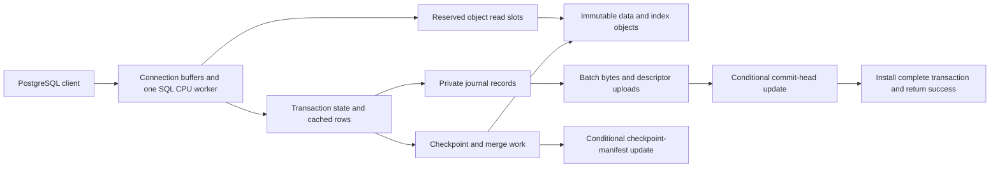

# How pos3ql works

pos3ql serves PostgreSQL SQL and protocol clients while saving durable state in
an S3-compatible object store. A configured object prefix contains one pos3ql
instance's durable state, including its SQL databases. One active process owns
the right to publish changes to that prefix. This is a single active writer
process, not a rule that every storage request must run in sequence.

**Example:** the same instance can contain `orders` and `billing` databases.
Their tables use the same startup memory budget and object-store namespace.
A backup or writer replacement concerns that namespace; creating a SQL database
does not create an independently operated storage service.

Startup may take exclusive recovery ownership before validating the remaining
journal. This prevents the previous writer from publishing while recovery runs;
a failed recovery can therefore leave that writer fenced out. The new process
accepts SQL writes only after journal replay and restored definitions validate.

## The request path

Connection input, parsed SQL, statement workspaces, transaction undo, locks,
object requests and output have separate fixed reservations. Catalog and derived
result descriptions retain their actual columns, rather than maximum-width table
definitions, in statement memory. Execution schemas share the existing startup
image pool.
After startup, ordinary runtime work cannot grow a heap, pool or sort allocation. The isolated
TLS transport uses its separately budgeted pool. The memory plan describes
these reservations; it is not the entire operating-system RSS, kernel socket
memory or the memory used by an independently operated object-storage service.

A reactor waits for sockets and deadlines, then advances ready connections and
maintenance. After each maintenance turn and any queries it wakes, the loop
registers newly opened storage sockets before sleeping. Cleanup therefore keeps
moving on an idle server without requiring another query to wake it.
SQL CPU work currently runs on one worker. An eligible read that
needs a download yields with its original data owners and command deadline;
another connection can run cached work. Adding connections or
`query_workspace_slots` does not add CPU execution workers.

A waiting command keeps the downloads it needs. Completion or failure releases
unused read-ahead requests. Commit does so once all required row images are in
the journal, before waiting for its durable receipt; an abandoned speculative
download cannot hold up the next checkpoint.

State-changing routines, procedure commit boundaries, administrative work and
large-result reads after their first transport flush still have synchronous
reads. A cold read on one
of these paths can occupy that worker. [PLAN.md](../PLAN.md) tracks their
conversion and the later CPU worker pool separately.

Function calls bind their selected function, input mapping and declared types
before running arguments. At execution, reached inputs and defaults run in
declaration order; lookup never evaluates an argument as a probe. Defaults keep the object identities
captured when the routine was created. A renamed sequence therefore cannot be
replaced accidentally by another sequence with its old name.

Lookup retains explicit built-in namespaces and compares compatible user and
built-in function signatures before selecting a call. An exact input-type match
can beat a generic match in an earlier schema; identical signatures follow
`search_path` order. Result fields come from the selected function's declaration,
including empty table-function results used by client metadata queries.
For example, with `search_path=public,pg_catalog`, a user's `sum(integer)`
can produce one value per input row; selecting the built-in aggregate instead
produces one value per group. Planning follows the selected declaration.
SQL constructors carry an explicit syntax tag through parsing and rewrites;
a quoted routine name cannot imitate an internal operator or JSON constructor.
The callable declarations come from PostgreSQL 18.6. Static name/OID indexes
and streamed candidates avoid a growing candidate list or runtime sort.
Planner safety facts also cover internal type-conversion procedures from the
pinned PostgreSQL catalog sources. For example, numeric text input is immutable,
while date input can depend on session settings. These facts guide planning;
they do not make additional procedures callable from SQL.

Conversion lookup also uses declared types, including typed NULL values, before
input effects. Each array child converts before the following child runs. For
`INSERT ... SELECT`, the SELECT's sorting and limits determine its output; each
complete output row then converts before the next row is produced. For example,
an overflowing first array child must not advance a sequence in a later child.

Some literal values are checked while SQL is prepared. For example, preparing
`SELECT '{approved}'::checked_status[]` can run checks on a domain, a type with
extra constraints. The same applies when an untyped string gets that array type
from a column or function parameter. The parser records each occurrence's
position, selected type identity and encoded value. Describe, Execute and
retries restore that value without repeating its checks. Equal literals at
different positions remain distinct inputs. A typed text expression or an
`ARRAY[...]` constructor keeps its later execution-time checks.

Checked values belong to the SQL source that analyzed them:

| Source | Input preparation and lifetime |
|---|---|
| Simple command | Prepared at command admission; a new command analyzes its inputs again. |
| SQL `PREPARE` or protocol Parse | Prepared once and retained with that statement and its bound portals. Describe and repeated execution reuse the values. |
| SQL string function or procedure body | `CREATE` validation is separate. The first runtime call prepares inputs retained by the backend for the routine definition and resolved call types. Later commands reuse them. |
| SQL function considered for inlining | The caller's planner checks the body. An accepted inline keeps its checked values with that caller plan; a rejected attempt leaves runtime preparation separate. |
| Supported static PL/pgSQL source | Prepared when reached and retained by the backend for that routine definition, resolved input types, input collation and source occurrence. An unreached branch does not prepare its inputs. |
| Dynamic `EXECUTE` | Each execution owns a fresh plan, even when the command text equals an earlier command. |
| Stored view, rule, default or SQL `BEGIN ATOMIC` body | Prepared with the definition and retained in its immutable metadata image, including domain and view-column defaults. Recovery restores values and captured type identities without rerunning checks. |

For example, an opaque SQL function containing a checked array literal checks
once at `CREATE`, then once at its first runtime call in that backend. A later
`SELECT` reuses that runtime value. A function considered for inlining can
check during planning even when the caller returns no rows; a rejected attempt
does not replace the first runtime check. Cursor plans retain accepted inputs
across separate `FETCH` commands and while a `WITH HOLD` cursor survives commit.

Parameterized Bind attempts keep separate checked planner values. Parameterless
Bind messages share their prepared statement's plan; each bound portal keeps
that plan alive. Bind retains decoded parameters through a preparation wait,
and cancellation releases the unfinished portal before another Bind can reuse
its slot. Planning can inspect already decoded parameters to skip a branch
such as `CASE WHEN $1=0 THEN checked_function() ELSE 17 END`, without running
the skipped function's constraints.

`DISCARD PLANS` makes future query admissions prepare again. Running calls and
bound portals or cursors retain their checked images; a compiled PL/pgSQL
function keeps its identity while its SQL statements can get new plans.
Ordinary PL statements without checked inputs or SQL planner candidates use
their enclosing function identity and reserve no checked-plan slot.
`DISCARD ALL` releases cached routine-input plans and their value owners.
Neither command re-evaluates inputs saved in schema definitions.
The [compatibility guide](postgresql-18-compatibility.md) records procedural
boundaries. Native regressions in `src/sql/tests/type_input_binding.rs` and
`src/sql/tests/type_input_positions.rs` retain the PostgreSQL 18.6 reference
SQL digests for these phase distinctions.

When an expression hands a mutable function to the engine, input preparation preserves completed
expressions, conversions, defaults and nested calls in the statement arena.
For example, `save_order(set_config('application_name',
current_setting('application_name') || '.', false))` appends one dot when the
input finishes across those function handoffs. Simple builtin trees that cannot
pause consume no retained input records. Engine-owned statistics, replication
and large-object calls use the same explicit handoff classification.

Waiting for another connection's lock can require restarting an unfinished
function body. Completed cursor operations and checked routine inputs keep
their results and sequence effects. A caught input-check error keeps its exact
failed attempt too; replay restores that error without running the check again.
If restarting would lose their data writes
or session changes, the command fails explicitly with `0A000` and rolls back;
it does not silently repeat or discard those effects. Retaining the remaining
function-body execution position is still a roadmap item.

SQL `SET` parses SQL syntax; `set_config` and saved settings take decoded values.
For example, `set_config('search_path', 'orders,public', false)` preserves that
spelling, while `SET search_path TO orders, public` stores a formatted SQL list.
Both validate the list before lookup. Routine scopes and transaction rollback
restore the stored value without parsing it again as SQL.

Scalar functions, table functions and procedures share input binding, while
keeping PostgreSQL's distinct null and result rules. Typed structural copies
preserve named and anonymous row fields through SQL and PL/pgSQL functions,
triggers, pending calls and the binary protocol. A named row is one value in
`SELECT make_order(1)`, but its declared fields become columns in
`SELECT * FROM make_order(1)`. A single-column `RETURNS TABLE` produces its
column value in the SELECT list; multiple columns produce a record. Result
descriptions use declared types and never sample an argument's value.
See [compatibility](postgresql-18-compatibility.md) for record, conversion and
capacity limits and the regression suites for individual cases.

Single-table statements with supported scalar expressions reuse the owned
physical reader across mutable function handoffs. Execution keeps the current
row, finishes its predicate once and retains each completed projection item
before advancing to the next. Function targets, original defaults, selected
conversions and whether null inputs skip a call bind before row effects.
Replacing a function can change its body when it starts, while the current
query keeps that null-handling
decision. A session-setting change in an earlier column cannot redirect
a later bound call. Each active row borrows the unused region of its existing
statement arena; completed output is copied before that region is released.
Nested function execution can borrow a further region without growing memory.
Row ownership and scan positions survive outside those temporary regions.
Completed function bodies also release their parsed statements, local values
and temporary plans. Only encoded results move into the caller's arena; this
applies to scalar functions, table functions and engine-owned calls, including
nested calls within a row. For example, a function can create and discard 64 KiB
of text for each of 1,100 input rows without retaining all that text. Live outer
locals and results still need space, and a single oversized call fails with
`54000` rather than growing memory.
Issued sequence numbers keep command-lived records in the owning arena. For
example, a number issued before a lock wait must not be issued again when that
command retries. Temporary row regions and the command's retained records share
a checked allocation frontier; recording an effect reserves space before it
runs, and ending a row preserves those command records.

This does not complete every query continuation. Complex plans, functions with
subqueries or set expansion, named/custom casts and function bodies still have
restart paths. The cursor reader retains simple table scans and one-row queries
without a table source, including scalar function calls and built-in casts.
Other cursor plans still materialize their results when opened. Cursors and results already sent to the
client need the same once-only execution positions before all storage waits can
yield. Exhaustion remains a named error; no extra per-table or per-query backing
allocation is introduced by the scoped row region. [PLAN.md](../PLAN.md) owns the
remaining acceptance and deployment qualification.

## Reads and storage layout

The durable layout is log structured: new transactions and saved generations
append immutable objects. Small mutable roots identify the committed log and
checkpoint inventory. An object with a content-derived name is never edited in
place. Local RAM and disk accelerate access and can be rebuilt from durable
state in object-store mode.

| Mechanism | What it saves | Example and limit |
|---|---|---|
| Full-slice column groups, called PAX | Downloads for columns that are not needed | Reading `id, status` can skip a large description column; predicates, reconstruction and exact checks can still require more columns |
| Packed, compressed row deltas | Descriptor and column-object overhead for small changes | Updating a few orders writes small row groups rather than a full wide-table slice |
| Eight-byte column extent alignment | Gives encoded column values aligned offsets within packed objects | This is a layout guarantee, not a CPU throughput or sector-size claim |
| Packed objects and verified byte ranges | Request overhead and unnecessary transferred bytes | Several independently verifiable extents can share an object; a ranged GET fetches the selected extent |
| Sparse row indexes and Bloom filters | Reading generations or groups that cannot contain a row | An absent order number can avoid a data read; several generations can still need checking |
| Durable value indexes | Searching unrelated rows or regions | Btree/hash, geometric bounds, interval bounds and GIN postings narrow candidates; exact SQL and visibility checks still determine results |
| Reuse of unchanged immutable groups | Rewriting already saved data | Checkpoint/merge work can reference unchanged PAX groups; changed groups still need output |
| Memory/disk caches and retained reader buffers | Repeated downloads and repeated decoding after a wait | A resumed query retains completed columns and navigation even if the shared cache evicted them |
| Bounded batches of object requests | Serial network round trips | Missing selected columns and independent physical writes can overlap within configured request slots |

These mechanisms are implemented; their production benefit has not been
quantified. PAX is a column-group layout within saved row generations. It does
not imply a separate user-selectable columnar table access method, vectorized
SQL execution, multi-core queries or Parquet compatibility.

An immutable sorted row file, or SST, orders versions by row identity and
commit position. Newer versions are considered before older versions for the
same row. A reader combines applicable saved generations with its resident
changes and deletion markers. Large rows can require an overflow chain;
reading one row is therefore not a fixed number of GET requests.

See [index navigation](index-navigation.md) for searchable summaries and exact
checks, and [durable formats](durable-format.md) for encodings and accepted
readers. PostgreSQL's catalog alignment and heap properties describe the SQL
interface; they do not prescribe pos3ql's object layout.

## Writes and the success response

1. SQL checks permissions, constraints and locks and prepares private row and
   catalog changes. Rollback records and journal staging must fit their pools.
2. Before durability, admission reserves replacement table/type definitions,
   index-binding roots and row keys. It retains the completed command while
   required locks or storage are unavailable.
3. A commit captures immutable journal bytes and a descriptor. Independent
   uploads can overlap, and several transactions can share the publication.
4. A conditional update advances the commit head only after the required
   uploads succeed. It preserves the committed predecessor and writer identity.
5. The complete transaction installs in memory, its visible position advances,
   locks release, and the server can send success.

**Example:** updating an order and its invoice in one transaction cannot expose
one changed value and one unchanged value during installation. An older report
can retain its earlier values. A new command waits through the installation
boundary rather than observing half a transaction.

Admission is still cancellable before durable publication. A wait preserves
completed defaults, triggers and buffered results; resuming it continues the
commit instead of executing the command again. Share relation locks protect
affected tables: ordinary SELECTs and unrelated work can proceed, while
conflicting writes wait. A prepared transaction captures its lock image after
admission has acquired those locks. Publication consumes reserved owners rather
than allocating or rebuilding metadata after durability.

After a restart, saved transactions reconstruct their private row and catalog
changes from the journal, including types, indexes and stored queries. Other
transactions still see the committed definitions. Once all startup catalogs
exist, stored-query references are bound separately for committed definitions
and each saved transaction's selected private definitions, in its own database.
For example, a saved schema rename keeps the original function usable until
commit, then its body reads the renamed table. `COMMIT PREPARED` completes
admission before making its decision durable, then installs these reserved
changes through normal publication. It does not replay allocating catalog
operations after confirming the decision. `ROLLBACK PREPARED` uses the same
captured identities and ordinary undo records to release them.

The commit head is ordered because confirmed transactions need one recoverable
history. This does not require serial uploads or serial future CPU execution.
Parallel CPU execution remains unfinished; concurrent object I/O is already
implemented. More upload slots do not remove root-update latency or conflicts
between transactions updating the same row.

With `object_store = off`, success instead requires local journal durability.
That mode cannot recover lost local-only data from an object store. With
object storage on, a lost success reply is an uncertain client outcome, not
permission to repeat an external payment blindly.

## Maintenance and scheduling

The server advances checkpointing, file merges, history cleanup, heap relocation
and eligible deletion in bounded turns. It runs between client messages and
while idle. Socket readiness resumes blocked network requests; owner contention
and failed maintenance use the existing one-second retry cadence. A quota of
64 visited row slots is a work bound, not a latency guarantee for a turn.

Row-location capture and relocation preflight visit the ordinary shared row
pool once, then the separate large-object pool. History cleanup also visits the
ordinary pool once and uses the large-object owner's cursor for its separate
reserve. It does not scan every shared slot again for each configured table.
Targeted cleanup follows only that table's owned links. Its typed cursor reports
a current position, a skipped stale position or completion; skipped positions
still count toward the work limit. Generation checks prevent a reused cell from
being treated as the earlier row.

A checkpoint writes captured committed versions and publishes a complete
manifest, the inventory of saved objects and definitions. Later commits remain
in the journal. Finishing an older checkpoint cannot clear newer writes or
ANALYZE results. Index output is eligible only when both its catalog identity
and its row-decoding context are committed; a committed index name alone cannot
make a private rewritten table shape safe to save. Merges combine saved
generations, retaining the versions needed by readers. Object deletion respects
current roots, retained readers and backups.
There is no need for an operating-system cron entry to drive this internal work.

`REINDEX` rebuilds from rows using the selected table shape and the existing
cache's transaction ownership. It does not turn a committed cache into a private
one or replace another transaction's cache. Rebuilding from rows also avoids
depending on the damaged saved index that the command is repairing.

Application jobs, migration scheduling and backup schedules are operator work.
There is no built-in SQL job scheduler or PostgreSQL background-worker ABI.
See [operations](operations.md#scheduled-work-and-schema-migrations) for examples
and [backup rules](backup-restore.md) before scheduling an offline backup command.

## Memory and physical size

`row_overlay_slots` budgets resident row metadata across ordinary tables in all
databases. It does not multiply by `max_tables`. The internal large-object table
keeps its separate `large_object_pages` allowance. Empty table identities and
other catalog structures still cost memory.

`row_work_bytes` is one foreground byte pool for retained row-ID lists and DML
buffers; `row_work_leases` bounds concurrent owners of that space. The byte
capacity must be a multiple of 64. Each allocation rounds up to 64-byte alignment,
using at most 63 alignment-padding bytes per live lease. Exact read captures
reserve their known row count. Active write buffers grow geometrically within
the hard pool limit, so their spare capacity also consumes this budget. If a
growing buffer cannot extend in place, both old and new ranges and both lease
descriptors remain charged until its data has been copied. Fragmented free
space or this temporary overlap can prevent a larger contiguous request. The
named error reports requested bytes, total free bytes, the largest free extent
and remaining lease descriptors. For example,
an update and a long report compete for this same budget, rather than each
reserving a maximum array for every potential table.

`table_metadata_bytes` reserves one shared backing pool for actual-length table
columns, physical column-number records, constraints, pending edit mappings and
index-binding collections, plus actual bytes of saved checked SQL inputs.
SQL sources without such inputs reserve no input payload. Its starter value is 64 MiB;
`table_metadata_leases` starts at 8,192 concurrently occupied ranges. File
configurations must name both settings. Bytes must be a positive multiple of 64;
allocator controls and per-table headers are additional startup reservations.
Prepared value-index keys also use one range per distinct row alongside schema
and binding ranges. Thus 8,192 leases is not an 8,192-row transaction limit:
bulk changes need room for their keys and the other live metadata. Exhaustion
fails before the journal becomes durable and rolls the changes back.
Each range rounds to 64 bytes. Fragmentation, retained old versions and the
overlap with replacement data can exhaust bytes or descriptors independently.
The named `54000` diagnostic identifies the metadata pool and requested, free
and largest contiguous bytes plus available descriptors. Pools never grow.

Each connection reserves `prepared_bytes` for every SQL and protocol prepared
statement slot, plus one `prepared_bytes` buffer for active input preparation.
For example, with `max_prepared=8`, those buffers reserve `17 * prepared_bytes`.
Text, parameter declarations and checked literal values share each buffer.
Exhaustion returns `54000`; increasing the setting takes effect at startup.

`routine_input_slots` reserves plan-control records per backend; the starter
configuration uses 128. Encoded values lease only their actual bytes from the
global `table_metadata_bytes` pool and consume its lease descriptors. There is
no maximum-sized value buffer per plan or per table. Nested and backend-static
plans share the fixed control capacity. Exhaustion returns `54000` naming
`routine_input_slots` or the metadata pool; neither grows at runtime.
The same input-slot limit bounds each backend's watched plans. A watch shares
the plan's actual dependency array; it does not reserve a list for every table.
The transaction's fixed DDL log retains matching invalidation receipts, so
commit and rollback use the selected object even if a name has changed or a
catalog slot is later reused. Other backends receive committed changes; an
aborted edit affects only its originating backend's cache.
The existing transaction TRUNCATE log also retains each affected table's creation
identity. These actual-length records share `table_metadata_bytes` and its lease
limit; no table-count-sized identity array is reserved per connection. The
transaction reserves only `max_ddl_per_transaction` event controls and its
existing table-name encoding buffer. Pool exhaustion returns `54000` before
publishing an event. No catalog lookup is needed after a table's definition has
been released.
Index renames preserve saved inputs. Whole-relation catalog statistics changes,
index creation, index deletion and TRUNCATE refresh plans that depend on the
affected table. Repeating ANALYZE without changing those catalog fields does
not itself require a new input check.
A compiled procedural function tracks its own definition. Each reached SQL
statement separately tracks its schemas, role-sensitive dependencies and
selected support functions, including custom operators and casts.

`statistics_bytes` and `statistics_leases` reserve a separate shared pool for
analyzed-column records. The starter configuration uses 1 MiB and 1,024 ranges.
Each immutable image stores only its analyzed columns, identified by their
original PostgreSQL column numbers. Readers, pending changes and checkpoints
retain selected images until they release them. `ANALYZE orders(total)` merges
that column's new statistics with the other columns' existing records. It
reserves the replacement before changing visible state. DDL removes statistics
for dropped or altered columns with the same admission and rollback rules.
Retained images and replacement overlap can return named `54000` exhaustion;
commit and rollback use the already admitted ownership.

`index_statistics_slots` independently bounds index activity counters; the
starter configuration uses 4,096 slots. Index creation reserves a counter
before catalog publication. Readers pin the selected index's qualified counter,
so a dropped index cannot redirect a late update to a replacement object.
Counter reset preserves catalog admission. A retired counter becomes reusable
after its readers release it. A table without indexes owns no such counter.

SERIAL defaults and identity columns use the shared sequence catalog rather
than another maximum-width counter array for every table. Sequence ownership
and the default expression are distinct: `OWNED BY NONE` removes the ownership
dependency while the column can continue calling that sequence.

A one-column table stores its actual columns instead of a maximum-width array.
Dropped columns still retain their PostgreSQL column numbers. Committed schemas,
pending edits and retained readers share immutable ownership; cloning a reader's
schema pin neither copies its payload nor reserves another range. Old and new
metadata remain charged until their last owners release them. Rollback and
prepared recovery preserve the selected object lifetime, including instance, database,
creation identity and schema revision; reusing a name or slot cannot redirect it.

`definition_image_slots` bounds retained execution-schema identities. Physical
images pin stored definitions; synthetic catalog images retain actual columns,
including their hidden suffix, in a separate typed payload. Image identifiers
include their owning pool and generation, so a stale or foreign identifier cannot
select another schema. CTEs, table functions
and trigger descriptions use borrowed column descriptors and actual statement
memory. They do not put owning schema leases or maximum-width definitions in
arenas that do not run destructors. Joined-row decoding also reserves only the
actual physical fields of each source. Recursive queries retain their internal
`SEARCH` ordering and `CYCLE` tracking fields in that physical shape while
exposing only the SQL-visible column prefix where required. Hiding a field
does not remove the scratch space needed to decode it. Checkpoint and relocation
reserves remain separate so foreground work cannot consume their progress capacity.

MVCC row history uses the explicit shared `row_history_slots` capacity across all tables and large
objects; `max_row_versions_per_row` remains a separate per-row bound. Locking
mode reserves no committed-row history. An update owns its prospective history
slot with its pending row chain, before durability. Queued and prepared commits
keep that ownership; commit links the reserved slot without allocating another,
and rollback releases it. History exhaustion returns `54000` at the write boundary.
Obsolete versions can be reclaimed while newer readers are active. On slot
pressure, write admission examines at most 64 row metadata positions and retries
with its owned input. Each history chain has the separate per-row version bound.
It never repeats SQL expressions or drains the whole
database synchronously; remaining pressure returns the named capacity error.
Foreign-table/catalog records and other fixed controls still add per-table
startup cost. Pending statistics and other definition families retain bounded
control slots, while column payloads share the independent statistics pool.
Row bytes, committed history and immutable
block caches also use shared startup pools. The
[adaptive resource design](adaptive-resources.md) separates implemented hard
capacities from future workload policies; no controller resizes startup backing
according to load. Catalog capacities remain independent: changing `max_tables`
does not silently resize indexes, routines, views or extended statistics.

The [embedded memory helper](https://github.com/e6qu/pos3ql/blob/main/examples/embedded-memory.rs) and
[runner script](https://github.com/e6qu/pos3ql/blob/main/tools/measure-embedded-capacity.py) measure 1, 8, 32 and 128
configured tables with the same explicit shared capacities in each transaction
mode, including table metadata, statistics backing and index-counter capacity. Its 64 samples
cover empty, hot, even, moving-demand, 64-column and schema/index replacement
workloads, plus narrow/wide statistics collection and targeted statistics
replacement through a type change and savepoint rollback. The single session
does not measure pinned-reader pressure; separate
ownership regressions cover that behavior. The helper retains named startup draws, configured reservation, peak resident
memory, stack size and startup time. Populated workloads are reported separately
from empty engines and include their session costs. These results must be
collected on CI; the script and configuration alone are not measurements.
The statistics pool is fixed independently of table count. Older samples used
implicit table-dependent sizing and retain that provenance.
The retained [empty-engine baseline](https://github.com/e6qu/pos3ql/blob/6ff1ac865a86a5318cb4934fbf01be0926667811/benchmarks/baselines/2026-10-30-embedded-startup/README.md)
includes raw measurements and their revision; its resident costs must not be
mistaken for configured byte reservations or a production minimum.
The helper uses the same explicit 128 MiB virtual stack reservation as the
server and native tests; ordinary operating-system thread defaults are not the
current execution contract. Peak resident memory includes the pages actually
touched. The debug-build helper records this stack size with each sample.
It also records each successful named startup reservation, so a large fixed
cost can be traced to its owning pool rather than inferred from total memory.
The retained [component breakdown](https://github.com/e6qu/pos3ql/blob/6ff1ac865a86a5318cb4934fbf01be0926667811/benchmarks/baselines/2026-10-30-embedded-components/README.md)
shows substantial fixed and per-table definition reservations in that revision;
reserved bytes alone do not establish which pages became resident.
The [before/after measurements](https://github.com/e6qu/pos3ql/blob/4054a6d3c79e916728f8e84d84139eae6d86b501/benchmarks/baselines/2026-10-30-embedded-lazy-definitions/README.md)
show empty-engine peak memory falling from about 735 MiB to 431 MiB with 32
configured table slots after unused pending definition payloads were left
uninitialized. Those historical debug-build samples do not measure the current
shared-schema implementation or establish a production memory minimum.

Capacity is the smallest applicable bound, not just the size of the bucket:

| Boundary | Current bound and practical meaning |
|---|---|
| Encoded immutable block | At most 262,144 bytes including its 52-byte header; payload at most 262,092 bytes |
| Saved row overflow | An inline head plus at most 16 overflow blocks; assembled encoded row at most 4,455,030 bytes. Input, statement and result buffers can impose smaller bounds |
| External execution-run row | At most 262,072 encoded bytes without overflow chaining, before other statement-memory limits |
| One row-generation roster | At most 8,190 referenced physical blocks, excluding the roster itself; indexes, filters, descriptors and overflow consume entries too |
| Index navigation within a generation | At most 4,096 index leaves; leaf and root addressability do not override the smaller physical-block roster |
| Resident row heap | `memtable_bytes` at most 4,294,967,295 bytes per buffer, with two buffers reserved; these are cache limits, not total durable table size |
| Table catalogs | `max_tables` at most 10,000 user table slots across the instance, plus the internal large-object relation; materialized-view backing tables consume slots |
| Global saved-block inventory | `checkpoint_live_blocks` must cover the distinct reachable block identities, including retained readers and backup data |
| Additional startup bounds | Manifest bytes, replayed commit batches, generations per table, merge/write entries, locks, transaction changes, connections and statement memory can fill first |

The 8,190-block roster gives a gross upper bound of about 2 GiB of framed
referenced block bytes for one generation if all blocks are full. It does not
promise a 2 GiB user table: metadata consumes entries, blocks can be short,
compression changes logical size, and a table can use several generations.

**Sizing example:** `checkpoint_live_blocks = 65536`, as in the development
configuration, corresponds to at most 16 GiB of full 256 KiB referenced block
bytes in that inventory. Small packed objects, metadata, indexes, historical
versions and backups reduce the useful row-data share. It is not a demonstrated
16 GiB database capacity or a limit that the object-store provider imposes.
Increasing a reservation requires a new startup plan and memory; it never grows
automatically. A larger bucket alone does not fix an exhausted inventory.

`row_overlay_slots` limits resident row metadata, not all saved rows. Saved rows
stream from immutable generations. Restoring a checkpoint installs their saved
file inventory without loading every row into the pool. Newer journal changes
still need resident slots and row bytes while startup replays them; a large
uncheckpointed tail can exhaust those reserves. Uncommitted changes and needed
history also consume their own resident capacity. A single large transaction can exhaust memory
while the durable table is small. Named exhaustion usually returns `54000`;
PostgreSQL-specific width errors retain their own codes. The
[capacity inventory](postgresql-18-compatibility.md#capacity-boundaries) owns
exact SQL widths and per-workspace reservations.

There is no qualified maximum database size, bandwidth, statements per second
or transactions per second for an independently operated deployment. The
[performance guide](performance.md#estimating-bandwidth-and-throughput) gives
explicit calculations and dated measurements without turning them into a
production guarantee.

## Schema migrations and binary changes

Application schema migrations use supported SQL through a normal client.
Changes such as ADD COLUMN, CREATE INDEX and type rewrites have their ordinary
locks, memory requirements and validation costs. Transactional DDL and savepoints
do not make a migration nonblocking or make an arbitrarily large rewrite fit.
A migration tool must coordinate which client applies each version; pos3ql does
not supply a migration runner or migration-history table.

Changing the pos3ql binary is separate. Earlier pos3ql format compatibility is
not required and there is no automatic format migration. Read the
[format matrix](durable-format.md), retain a recoverable source and verify a
logical export/restore when formats differ. A same-prefix backup does not
convert its bytes to a new format. PostgreSQL physical backup/WAL tools cannot
read pos3ql objects.

## Source map and outstanding work

| Source | Responsibility |
|---|---|
| `src/server.rs`, `src/pg/` | Connections, wire protocol, readiness events, retained waits and response order |
| `src/sql/` | Parsing, type checks, execution, transaction coordination and PostgreSQL catalogs |
| `src/storage/` | Resident versions, locks, retained definitions, object lifetimes and fixed metadata pools |
| `src/wal/` | Journal record framing, checksums, staging and recovery codec |
| `src/checkpoint.rs` | Saved generations, merges, manifest publication, retention and cold recovery |
| `src/store/` | Block formats, compression, immutable indexes, ranged access and cache tiers |
| `src/object_store.rs`, `src/object_store/` | Provider-neutral outcomes, S3 HTTP/TLS, signing and conditional operations |
| `src/mem/`, `src/config.rs` | Startup sizing, fixed buffers/pools and allocation enforcement |

`src/storage/catalog_identities.rs` checks durable catalog creation stamps and
counter reservations. `default_acls.rs` keeps a default-permission group's
identity separate from its recipients; `partition_triggers.rs` stores inherited
trigger identities and modes in the existing startup-reserved matrix. SQL records
private changes for rollback and publishes their final expected/replacement
images at commit. Checkpoint and journal readers restore saved positions and
reject references to replacement objects. Database copies rebind parent links
within the new database before installing inherited triggers.

Journal cleanup uses a separate fixed metadata client and retains its listing,
backup-retention and deletion positions across socket waits. It can run while
foreground block reads and journal uploads wait. It has its own fixed backup
list and deletion queue, so checkpoints can publish and free row-cache space
while obsolete-log requests wait. A pass has a fixed cutoff; newer checkpoints
queue the latest next cutoff instead of restarting the active pass.
Saved-file cleanup uses a second fixed client and retains its backup, manifest,
row-roster, index-tree and deletion positions across waits. Its cache probes
preserve query read owners. It validates the complete keep-set before deleting
files, then continues each listing from its saved cursor. Durable file writers
remain paused while that decision drains; foreground RAM edits can continue.
Row-file merges retain index descent, source-row scheduling, column downloads
and large-row fragments while a request waits. Scheduling reads row descriptors
without fetching PAX column values. Completed groups stay in the existing source
buffers; checksums and output positions advance only after their rows finish.
The fixed read pool reserves one maintenance owner alongside connections and
subscription workers. Checkpoint row capture, row output, index input scans,
sort-run merges and final index output use the same maintenance owner. Each
retains its exact next input; a waiting job resumes before another job can
reuse that owner's response. Private startup-reserved row and scan buffers keep
partially read values separate from foreground queries. An emitted index row
is consumed once even if fetching its successor has to wait.

For example, while an index on saved `orders(customer_id)` waits for storage,
a cached order lookup and another connection's durable commit can finish.
The index becomes visible as a saved root only after its complete output uploads
and the matching manifest publishes. Replacing its table or changing its inputs
abandons the old job and releases its read request.

The remaining order is coherent shared row/catalog publication and bounded
maintenance, startup-reserved CPU workers, then representative performance and
multi-host recovery/failover qualification. Current [behavior](implemented-baseline.md),
[known limits](postgresql-18-compatibility.md), [operations](operations.md) and
[the plan](../PLAN.md) each own one part of that contract.
