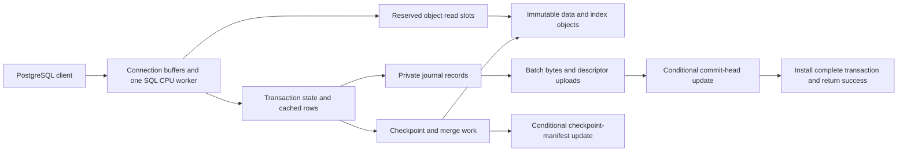

# How pos3ql works

pos3ql serves PostgreSQL SQL and protocol clients while saving durable state in
an S3-compatible object store. A configured object prefix contains one pos3ql
instance's durable state, including its SQL databases. One active process owns
the right to publish changes to that prefix. This is a single active writer
process, not a rule that every storage request must run in sequence. Ownership
is a conditional writer-fence object, not a time-based lease: a replacement
process fences the old one, whose next publication fails. There is no read-only
shared-snapshot protocol for other processes reading the same prefix.

**Example:** the same instance can contain `orders` and `billing` databases.
Their tables use the same startup memory budget and object-store namespace.
A backup or writer replacement concerns that namespace; creating a SQL database
does not create an independently operated storage service.

Startup may take exclusive recovery ownership before validating the remaining
journal. This prevents the previous writer from publishing while recovery runs;
a failed recovery can therefore leave that writer fenced out. The new process
accepts SQL writes only after journal replay and restored definitions validate.

## The request path

Connection input, parsed SQL, statement workspaces, transaction undo, locks,
object requests and output each have a fixed reservation made at startup. After
startup, ordinary runtime work cannot grow a heap, pool or sort allocation; the
isolated TLS transport uses its own separately budgeted pool. The memory plan
covers these reservations only, not total operating-system RSS, kernel socket
memory or the object-storage service. See
[memory and physical size](#memory-and-physical-size).

### Execution model

A **reactor** is the event loop that waits for socket readiness and deadlines.
Each turn it advances ready connections and a bounded amount of maintenance,
then registers newly opened storage sockets before sleeping, so cleanup keeps
moving on an idle server.

All SQL CPU work runs on **one SQL CPU worker**. Adding connections or
`query_workspace_slots` adds concurrent sessions and workspaces, not CPU
execution workers. Several CPU workers are future work:
[PLAN.md](../PLAN.md#run-sql-on-several-cpu-workers).

When a command needs an object that is not cached, it can **yield**: it keeps
its read requests, data owners and original command deadline, and the worker
runs another connection's cached work until the download arrives. A path that
cannot yield **blocks**: the read completes synchronously and occupies the
worker. Completion or failure releases unused read-ahead requests. Commit does
so as soon as its row images are in the journal, so an abandoned speculative
download cannot hold up the next checkpoint.

The rule for statements: a statement can yield until it performs its first
**effect** — something a restart could not undo or repeat. Effects are calling
a volatile function or a user routine body, issuing `nextval`/`setval`, and
output actually reaching the client. After the first effect, the remaining
reads of that statement block until the statement ends.

**The worker never waits for a client.** A result larger than the
connection's send buffer (`conn_send_buffer_bytes`) queues in the
connection's **overflow area**: rows lease space from the shared result spool
(`result_spool_bytes` / `result_spool_leases`), and a private reserve the
size of the send buffer always holds the closing `CommandComplete`,
`ErrorResponse` and `ReadyForQuery`. Socket writes are non-blocking for both
plaintext and TLS. While a client reads slowly, the statement still finishes,
and the connection then waits for the client to read its queued output before
it processes the next message (pipelined messages wait in order); other
connections keep running. A client that falls further behind than the spool
receives the rows already queued, then `54000` naming `result_spool_bytes`, and
its session stays usable; an implicit transaction rolls back and an explicit
one becomes failed. Notifications are held while a result is in progress and
delivered after it. Bytes leave during a statement only where no object-store
publication can follow: in local mode, and for a lone `SELECT`, `SHOW`,
`VALUES` or `TABLE` in object-store mode until it starts an effect; other
output waits for durable publication before any byte is written. A statement
attempt that has called a SQL-language routine may still replay, so its rows
stay queued until it finishes; if such a routine is first called after rows
already reached the client, the statement fails with `0A000` instead of
repeating them.

**Large results resume row by row.** Before a top-level `SELECT` or
`COPY ... TO STDOUT` runs (simple Query or extended `Execute`), the engine
decides whether it (or the query a COPY reads: its own, or `SELECT columns
FROM ONLY table` for a table) can become a **result stream**: one ordinary table, or one builtin set-returning function
with constant arguments (`generate_series`, a one-array `unnest`), without
joins, grouping, sorting, `DISTINCT`, set operations, subqueries, CTEs, row
locking or row security, whose read position (one record per resident row
plus the query text) fits `result_stream_bytes`. If such a statement's output first outgrows
the send buffer before any byte left and before any effect, that attempt is
discarded and the statement reopens from a retained read position in the
connection's `result_stream_bytes` allocation. It then delivers rows while the
client reads and yields when the client is behind (`Client`/`ClientWrite` in
`pg_stat_activity`), when a row waits for an object download, and when a row
waits for a lock. Delivered rows are final: a wait inside a row rolls back and
re-evaluates only that row, and an effect makes only the rest of that row read
synchronously. A delivered row's receipts (sequence values, routine results)
are released before the next row starts, so statement memory holds one row's
receipts however long the stream runs. Every other large result uses the spool above, decided before
any of its rows reach the client; `pos3ql_result_stream_spooled_total` counts
those by reason (`shape`, `capacity`, `effects`). A spooled result yields on
cold storage only until its first byte reaches the client, then reads
synchronously until it ends. Today that covers joins, grouping, sorted
results, subqueries, set operations, `VALUES` lists, other function sources,
row locking, row security, a result that started an effect before it
overflowed, and a `FETCH` from a scrollable cursor. A buffered paged portal
sends nothing before its first page, so its reads yield throughout.

A forward `FETCH n` or `FETCH ALL` (simple Query or unpaged `Execute`) from
a cursor that reads as it fetches and saves no history (`NO SCROLL`, or a
forward-only shape) opens such a stream over the cursor's own retained query
before its first row: rows are evaluated as the client reads them, none is
saved in `cursor_bytes`, and the cursor's position advances with each
delivered row. A failure after delivered rows marks the cursor failed, as
PostgreSQL does. Scrollable cursors still buffer a `FETCH` in `cursor_bytes`,
because they save every visited row for backward motion.

**Paged portals evaluate rows per `Execute`.** An `Execute` with a row limit
opens such a statement's stream before its first row. Each `Execute`
evaluates only the rows it returns, then the portal suspends with
`PortalSuspended`, keeping its read position and snapshot while other
statements of the transaction run. The connection has one stream allocation:
while a suspended portal holds it, other large results spool for `capacity`,
and another paged portal buffers its whole result in `portal_result_bytes`
(`54000` naming that setting when full), as do paged portals of other shapes.
DDL on a suspended portal's table fails with `55006`, as in PostgreSQL. The
stream ends when its portal completes, is closed or rebound, or its
transaction ends.

**Example:** `SELECT id, payload FROM orders` sent by a client on a slow link
delivers rows as the client reads them; while it waits for the client or for a
cold block of `orders`, other connections run. `SELECT ... FROM orders ORDER
BY id` sorts first, so its output queues in the spool instead.

| Path | Cold storage read |
|---|---|
| Queries before their first effect, including reads inside explicit transactions | Yields |
| Journal uploads and the commit's wait for its durable receipt | Yields |
| Maintenance: checkpoint capture, merges, index builds, journal and saved-file cleanup | Yields, using a separate maintenance read owner and fixed clients |
| A statement after its first effect (volatile function, routine body, sequence change, first output byte reaching the client) | Blocks until the statement ends |
| Output queued for a slow client | Never blocks; the connection waits for the client between messages |
| Result streams (see above), including `COPY ... TO STDOUT` and a streamed `FETCH`: each row before its first effect | Yields; delivered rows are kept |
| Writing statements: `INSERT`, `UPDATE`, `DELETE`, `MERGE`, data-modifying `WITH`, DDL, `CALL`, `DO`, `COPY FROM` | Blocks for the whole statement |
| Commit processing, deferred constraint triggers, `SET CONSTRAINTS`, `PREPARE TRANSACTION`, `COMMIT PREPARED`/`ROLLBACK PREPARED` | Blocks |
| `COPY FROM` rows and completion; a `COPY TO` that cannot stream once its first byte reaches the client; logical-replication apply and initial copy | Blocks |
| Large-object fast-path calls, login event triggers, manual `CHECKPOINT` | Blocks |

Lock waits are separate: a command waiting for a row, table or advisory lock
parks with its saved state, including inside procedural code, and the worker
runs other connections. Converting the blocking paths is tracked in
[PLAN.md](../PLAN.md#pause-and-resume-every-query-path).

**Example:** while one connection waits for a cold `orders` column, another
connection's cached lookup and a third connection's commit can finish. If the
first connection's statement had already called `nextval('order_ids')`, its
remaining reads would instead block the worker.

### How saved state is owned

A paused command must resume exactly where it stopped, without repeating
effects. The general rule: **everything needed to resume moves out of
temporary statement memory into a startup-reserved owner before the command
pauses**, and every completed effect leaves a **receipt** that resumption
replays instead of running the effect again.

| Saved state | Owner |
|---|---|
| Procedural positions, lexical frames, source images, resolved local declarations, loop scopes, named-output bindings, caught error text | `execution_control_bytes` / `execution_control_leases` |
| Saved local values, trigger `OLD`/`NEW` rows and arguments, transition tables, loop inputs, set-returning results, `EXECUTE ... INTO` results | `row_work_bytes` / `row_work_leases` |
| Completed function results, argument values, selected functions and casts, sequence and advisory-lock receipts | The statement arena's retained region (the invocation log), within existing statement capacity |
| Checked literal inputs saved with routines and stored definitions | `table_metadata_bytes` / `table_metadata_leases`, with `routine_input_slots` control records |
| Execution schemas | `definition_image_slots` |
| Result output queued for a slow client | Rows: `result_spool_bytes` / `result_spool_leases`, released as soon as the client drains them. Closing messages: a private reserve of `conn_send_buffer_bytes` per connection |
| A result stream's query text, parameters, row positions and saved-file readers | `result_stream_bytes` per connection; released at completion, error, cancel, timeout or disconnect, and for a paged portal when the portal is closed or rebound or its transaction ends. Not visible in `pg_cursors` and not counted in `max_cursors`. A streamed `FETCH` keeps its rows' state in its cursor's own allocations |

Further rules that apply to every saved owner:

- **Environment.** A paused call saves its search path, settings, effective
  user, statement and transaction timestamps and original deadline, and
  reinstalls them on resume. Another connection cannot lend it settings or
  renew its timer. A failed reattachment restores the caller's environment.
- **Identity checks.** Saved state records its connection, database,
  transaction, command and arena. Resuming under a different owner fails with
  `40001` or an internal error before changing any state, and leaves the saved
  state intact.
- **Receipts.** For example, a function that writes an audit row, issues an
  order number, then waits for an advisory lock resumes with the same local
  values and writes that audit row once. `PERFORM write_audit('one'),
  wait_for_lock(), write_audit('two')` inserts each row once even if the lock
  waits repeatedly; a second lock call in the same statement reuses the first
  call's receipt instead of taking another hold.
- **Unsupported restarts fail loudly.** A path that cannot save its progress
  returns `0A000` and rolls back rather than repeat a write — for example
  `SQL row expression requires retained write progress`, or an unsaved volatile
  value such as `random()`. Contexts with no resumable executor reject advisory
  unlocks with `0A000`.
- **Typed wait markers.** Internal waits use a typed marker, not a SQLSTATE.
  An application raising `PZ001` returns or catches it normally; it cannot park
  a connection.
- **Exhaustion.** A full pool returns `54000` naming its settings. Growing a
  saved buffer reserves its replacement first, so failure keeps the previous
  value readable.

Write completion follows PostgreSQL's
[write executor](https://github.com/postgres/postgres/blob/REL_18_STABLE/src/backend/executor/nodeModifyTable.c):
drain row events, run AFTER statement triggers in order (MERGE runs them in
DELETE, UPDATE, INSERT order; `INSERT ... ON CONFLICT DO UPDATE` runs UPDATE
before INSERT), then return one completion. Direct table writes without rewrite
rules hand that completion to a retained owner, so a waiting AFTER trigger
resumes without redoing the insert, update or delete, and earlier `RETURNING`
rows are kept. Nested INSERT, UPDATE and DELETE inside a trigger hand their
AFTER work to the calling trigger. BEFORE and INSTEAD OF triggers, modifying
CTEs, rewrite rules, `COPY` and replication apply do not yet have this owner.

With `track_functions = 'all'`, an active function timer owns one of 1,024
entries on the SQL execution thread. A paused call releases its entry and
re-admits it on resume, so another client's calls are not counted as its
children. Exhaustion returns `54000` naming the function timing stack.

### Statement preparation

Function calls bind their selected function, argument mapping and declared
types before running arguments, using PostgreSQL 18.6 declarations through
static indexes rather than a growing candidate list. Defaults keep the object
identities captured at creation, so a renamed sequence cannot be replaced by
another sequence with its old name. Planner safety facts cover all 3,397
procedures in the pinned PostgreSQL catalog, including internal ones that are
not callable from SQL;
[source hashes](https://github.com/e6qu/pos3ql/blob/d79ba0232874d6dfbd7a9f7a744af9a9a12f3318/tests/external/reference/2026-11-03-input-plans/planner-procedure-properties.json)
record their origin.

Some literals are checked when SQL is prepared, such as
`'{approved}'::checked_status[]`, where `checked_status` is a domain (a type
with extra constraints). The checked value belongs to the SQL source that
analyzed it:

| Source | When inputs are checked and how long they are kept |
|---|---|
| Simple command | At admission; a new command checks again |
| SQL `PREPARE` or protocol Parse | Once; kept with the statement and its portals |
| SQL function or procedure body | `CREATE` validates; the first runtime call in a backend checks again and the backend keeps the result |
| SQL function considered for inlining | By the caller's planner; kept with the caller's plan if inlined |
| Static PL/pgSQL statement | When first reached; kept by the backend for that definition, input types and collation |
| Dynamic `EXECUTE` | Every execution |
| View, rule, default or `BEGIN ATOMIC` body | With the definition; kept in its immutable metadata image and restored at recovery without re-checking |

`DISCARD PLANS` makes later admissions prepare again; running calls, portals
and cursors keep their checked images. `DISCARD ALL` also releases cached
routine-input plans. Neither re-evaluates inputs saved in schema definitions.
Native regressions in `src/sql/tests/type_input_binding.rs` and
`src/sql/tests/type_input_positions.rs` retain the PostgreSQL 18.6 reference
SQL digests for these distinctions.

Parse, Bind, Describe and `COPY` each restore their own connection's user,
search path, timezone and command timestamps. The original command deadline is
not renewed between protocol messages; an expired Sync still completes error
recovery with ReadyForQuery. Once durable publication starts, a timeout cannot
cancel the required commit receipt.

Leaving a routine configured with `SET` restores only the settings named in that
clause; an explicit session-wide `SET` inside it survives. A connection-wide
64-bit setting counter never wraps; exhausting it returns `54000` with
`session setting assignment counter exhausted`. These rules follow PostgreSQL's
[SET contract](https://www.postgresql.org/docs/18/sql-set.html).

PostgreSQL reference captures for procedural execution:
[nested results](https://github.com/e6qu/pos3ql/blob/main/tests/external/reference/2026-11-06-nested-callback-results/README.md),
[saved output scopes](https://github.com/e6qu/pos3ql/blob/main/tests/external/reference/2026-11-06-saved-output-scopes/README.md),
[name bindings](https://github.com/e6qu/pos3ql/blob/main/tests/external/reference/2026-11-06-procedural-name-bindings/README.md),
[lexical scopes](https://github.com/e6qu/pos3ql/blob/main/tests/external/reference/2026-11-06-procedural-lexical-scopes/README.md),
[parameter scopes](https://github.com/e6qu/pos3ql/blob/main/tests/external/reference/2026-11-06-procedural-parameter-scopes/README.md)
and [caught diagnostics](https://github.com/e6qu/pos3ql/blob/main/tests/external/reference/2026-11-06-caught-diagnostics/README.md).
The [compatibility guide](postgresql-18-compatibility.md) owns the supported
SQL and procedural surface.

### Commit publication

A commit stages private journal records, uploads them, then conditionally
advances the commit head before the transaction becomes visible and the client
sees success; [writes and the success response](#writes-and-the-success-response)
gives the steps. A storage wait during publication resumes that publication; it
never executes the command again. Standalone utilities with an immediate commit
boundary, such as `CREATE DATABASE`, finish durable publication before their
Execute response.

## Reads and storage layout

The durable layout is log structured: new transactions and saved generations
append immutable objects. Small mutable roots identify the committed log and
checkpoint inventory. An object with a content-derived name is never edited in
place. Local RAM and disk accelerate access and can be rebuilt from durable
state in object-store mode.

| Mechanism | What it saves | Example and limit |
|---|---|---|
| Full-slice column groups, called PAX | Downloads for columns that are not needed | Reading `id, status` can skip a large description column; predicates, reconstruction and exact checks can still require more columns |
| Packed, compressed row deltas | Descriptor and column-object overhead for small changes | Updating a few orders writes small row groups rather than a full wide-table slice |
| Eight-byte column extent alignment | Gives encoded column values aligned offsets within packed objects | This is a layout guarantee, not a CPU throughput or sector-size claim |
| Packed objects and verified byte ranges | Request overhead and unnecessary transferred bytes | Several independently verifiable extents can share an object; a ranged GET fetches the selected extent |
| Sparse row indexes and Bloom filters | Reading generations or groups that cannot contain a row | An absent order number can avoid a data read; several generations can still need checking |
| Durable value indexes | Searching unrelated rows or regions | Btree/hash, geometric bounds, interval bounds and GIN postings narrow candidates; exact SQL and visibility checks still determine results |
| Reuse of unchanged immutable groups | Rewriting already saved data | Checkpoint/merge work can reference unchanged PAX groups; changed groups still need output |
| Memory/disk caches and retained reader buffers | Repeated downloads and repeated decoding after a wait | A resumed query retains completed columns and navigation even if the shared cache evicted them |
| Bounded batches of object requests | Serial network round trips | Missing selected columns and independent physical writes can overlap within configured request slots |

These mechanisms are implemented; their production benefit has not been
quantified. PAX is a column-group layout within saved row generations. It does
not imply a separate user-selectable columnar table access method, vectorized
SQL execution, multi-core queries or Parquet compatibility.

An immutable sorted row file, or SST, orders versions by row identity and
commit position. Newer versions are considered before older versions for the
same row. A reader combines applicable saved generations with its resident
changes and deletion markers. Large rows can require an overflow chain;
reading one row is therefore not a fixed number of GET requests.

Eligible two-source equality joins use a bounded hash build over tables,
catalogs, derived results and external sort runs. Up to eight equality keys,
NULL keys, duplicate matches, extra `ON` conditions and `LEFT JOIN` share that
path. A build estimated beyond its fixed 32,768-entry ceiling, a lateral or
partitioned source, or incompatible key types selects a nested-loop plan before
execution; `EXPLAIN` reports the same choice.

See [index navigation](index-navigation.md) for searchable summaries and exact
checks, and [durable formats](durable-format.md) for encodings and accepted
readers. PostgreSQL's catalog alignment and heap properties describe the SQL
interface; they do not prescribe pos3ql's object layout.

## Writes and the success response

1. SQL checks permissions, constraints and locks and prepares private row and
   catalog changes. Rollback records and journal staging must fit their pools.
2. Before durability, admission reserves replacement table/type definitions,
   index-binding roots and row keys. It retains the completed command while
   required locks or storage are unavailable.
3. A commit captures immutable journal bytes and a descriptor. Independent
   uploads can overlap, and several transactions can share the publication.
4. A conditional update advances the commit head only after the required
   uploads succeed. It preserves the committed predecessor and writer identity.
5. The complete transaction installs in memory, its visible position advances,
   locks release, and the server can send success.

**Example:** updating an order and its invoice in one transaction cannot expose
one changed value and one unchanged value during installation. An older report
can retain its earlier values. A new command waits through the installation
boundary rather than observing half a transaction.

Admission is cancellable before durable publication. A wait preserves
completed defaults, triggers and buffered results; resuming continues the
commit instead of executing the command again. Share relation locks protect
affected tables: ordinary SELECTs and unrelated work can proceed, while
conflicting writes wait. Publication consumes reserved owners rather than
allocating or rebuilding metadata after durability.

After a restart, saved prepared transactions reconstruct their private row and
catalog changes from the journal, including types, indexes and stored queries,
bound in their own database against their own private definitions. Other
transactions still see the committed definitions. `COMMIT PREPARED` completes
admission before making its decision durable, then installs the reserved
changes through normal publication; `ROLLBACK PREPARED` releases them with the
same captured identities and ordinary undo records.

The commit head is ordered because confirmed transactions need one recoverable
history. This does not require serial uploads. More upload slots do not remove
root-update latency or conflicts between transactions updating the same row.

With `object_store = off`, success instead requires local journal durability.
That mode cannot recover lost local-only data from an object store.

No success response crosses the durability boundary. If durable publication
fails, buffered success responses waiting on it are replaced by that error; a
client whose commit was staged instead receives fatal `08007` `commit outcome is unknown;
reconnect before checking it` and its connection closes. With object storage
on, a lost success reply is an uncertain client outcome, not
permission to repeat an external payment blindly.

## Maintenance and scheduling

The server advances checkpointing, file merges, history cleanup, heap relocation
and eligible deletion in bounded turns, between client messages and while idle.
No operating-system cron entry is needed for this internal work. Socket
readiness resumes waiting network requests; owner contention and failed
maintenance retry every second. A quota of 64 visited row slots per turn is a
work bound, not a latency guarantee.

- **Checkpoint:** writes captured committed versions and publishes a complete
  manifest, the inventory of saved objects and definitions. Later commits stay
  in the journal. Finishing an older checkpoint cannot clear newer writes or
  ANALYZE results. Index output is saved only when both its catalog identity
  and its row-decoding context are committed.
- **Merge:** combines saved generations, keeping versions needed by readers.
- **Deletion:** respects current roots, retained readers and backups.
- **History cleanup and relocation:** visit the ordinary shared row pool once
  per pass and the large-object pool separately; a typed cursor reports current,
  skipped-stale or complete positions, and generation checks prevent a reused
  cell from being treated as the earlier row.

Maintenance waits do not block foreground work. Checkpoint row capture, row
output, index input scans, sort-run merges and index output share one
maintenance read owner, reserved in the fixed read pool alongside connections
and subscription workers, with private startup-reserved row and scan buffers.
Journal cleanup and saved-file cleanup each use their own fixed metadata
client, backup list and deletion queue, and keep their listing positions across
waits. Saved-file cleanup validates the complete keep-set before deleting;
durable file writers pause while that decision drains, while foreground RAM
edits continue. A cleanup pass has a fixed cutoff; newer checkpoints queue the
next cutoff instead of restarting it.

**Example:** while an index on saved `orders(customer_id)` waits for storage, a
cached order lookup and another connection's commit can finish. The index
becomes a saved root only after its complete output uploads and the matching
manifest publishes. Replacing its table or changing its inputs abandons the old
job and releases its read request.

`REINDEX` rebuilds from rows, not from the possibly damaged saved index, using
the selected table shape. `REINDEX TABLE CONCURRENTLY orders` follows
PostgreSQL's phases: commit replacement catalog entries, wait for earlier
writers, build, validate against later writes, wait for earlier readers, swap
names and constraint links, then retire and drop the old indexes. A primary-key
constraint keeps its identifier and comment; its backing index gets a new one.
Cancellation can leave a committed invalid replacement or retired index, as in
PostgreSQL. Concurrent rebuilding of an exclusion index is rejected; a table
rebuild warns and skips exclusion indexes and live invalid indexes. Schema and
database rebuilds finish one table at a time, and their end hooks report each
index's current name. Keys keep the name chosen at creation: renaming `orders`
to `archived_orders` preserves `orders_pkey`. Changing a table's owner changes
its live indexes' owners in the same transaction. See the
[compatibility guide](postgresql-18-compatibility.md) for supported boundaries.

Application jobs, migration scheduling and backup schedules are operator work.
There is no built-in SQL job scheduler or PostgreSQL background-worker ABI.
See [operations](operations.md#scheduled-work-and-schema-migrations) for examples
and [backup rules](backup-restore.md) before scheduling an offline backup command.

## Memory and physical size

Every pool below is reserved at startup and never grows. Exhaustion returns
`54000` naming the pool or its settings, with requested bytes, free bytes, the
largest free extent and remaining lease descriptors where applicable. Byte
pools must be positive multiples of 64; each range rounds up to 64 bytes, and
fragmentation or old/new overlap during a replacement can exhaust bytes or
descriptors independently. File configurations must name each byte/lease pair
explicitly.

### Shared memory pools

| Setting | What it holds | Notes |
|---|---|---|
| `row_overlay_slots` | Resident row metadata for ordinary tables in all databases | Not multiplied by `max_tables`. Saved rows stream from immutable generations; only resident changes, uncheckpointed journal replay and needed history use slots |
| `large_object_pages` | The internal large-object table | Separate from `row_overlay_slots` |
| `row_history_slots` | MVCC row history across all tables and large objects | `max_row_versions_per_row` is a separate per-row bound. An update owns its history slot before durability; on pressure, admission examines at most 64 row metadata positions, then returns the named error. Locking mode reserves none |
| `row_work_bytes` / `row_work_leases` | Retained row-ID lists, DML buffers and saved procedural row state | Read captures reserve their known row count; write buffers grow geometrically within the pool, and a moving buffer keeps both ranges charged until copied. An update and a long report compete for the same budget |
| `execution_control_bytes` / `execution_control_leases` | Procedural positions, frames, source images, local declarations and value slots, named-output bindings, saved outputs, caught error directories and text | Ranges are sized to actual source text and maximum lexical, loop and handler nesting, and admitted before local initializers. Startup accounting includes lease and free-range records |
| `table_metadata_bytes` / `table_metadata_leases` | Actual-length columns, physical column numbers, constraints, pending edit mappings, index bindings, saved checked SQL inputs, TRUNCATE identities, prepared value-index keys | Starter: 64 MiB and 8,192 leases. Keys use one range per distinct row, so 8,192 leases is not an 8,192-row transaction limit. Exhaustion fails before the journal becomes durable |
| `statistics_bytes` / `statistics_leases` | Analyzed-column statistics images | Starter: 1 MiB and 1,024 ranges. `ANALYZE orders(total)` merges that column with existing records and reserves the replacement before publishing |
| `index_statistics_slots` | Index activity counters | Starter: 4,096. Reserved at index creation; a table without indexes owns none |
| `definition_image_slots` | Retained execution-schema identities | A paused trigger pins its completion's existing image rather than reserving another |
| `result_spool_bytes` / `result_spool_leases` | Result rows queued behind clients that read slower than statements produce them | A connection holds at most one lease, growing geometrically and returned once its queue drains. Exhaustion fails only the lagging statement with `54000` after the rows already queued |
| `memtable_bytes` | Resident row heap | At most 4,294,967,295 bytes per buffer, two buffers reserved; a cache limit, not total table size |

**Example:** a function with 128 declared locals and one named input stages
that one parameter, then releases the staging range. It does not reserve a
second 129-value array; larger text or record payloads live in statement or
row-work memory.

### Per-connection and per-transaction reservations

| Setting | Reservation |
|---|---|
| `prepared_bytes`, `max_prepared` | One `prepared_bytes` buffer per prepared-statement slot plus one for active input preparation: `max_prepared=8` reserves `17 * prepared_bytes`. Text, parameter declarations and checked literals share each buffer |
| `routine_input_slots` | Plan-control records per backend (starter: 128), also bounding watched plans. Values lease actual bytes from `table_metadata_bytes` |
| `max_ddl_per_transaction` | DDL event controls per transaction; actual-length records use `table_metadata_bytes` |
| `cursor_query_bytes` | Per-cursor query state, including the declared type IDs a `WITH HOLD` cursor keeps after commit |
| `cursor_bytes` | Per-cursor typed output rows, sharing their bytes and `floor(cursor_bytes / 6)` row positions with the saved input rows a scrollable cursor evaluates again or an ordered row-locking cursor sorts |
| `conn_send_buffer_bytes` | Reserved twice per connection: the send buffer and the private output reserve that holds a result's closing messages. The largest single backend message must fit it |
| `result_stream_bytes` | One result stream per connection; required (starter: 256 KiB, minimum 64 KiB); zero disables streams. The estimate counts every resident row of the table, so a table with many uncheckpointed rows spools instead |
| Held notifications | 64 KiB per connection for notifications that arrive while a result is in progress; a listener further behind is closed rather than sent a truncated stream |

Tables store their actual columns, not a maximum-width array; dropped columns
keep their PostgreSQL column numbers. Committed schemas, pending edits and
retained readers share immutable images, and old and new metadata stay charged
until their last owner releases them. Catalog capacities are independent:
changing `max_tables` does not resize indexes, routines, views or extended
statistics. SERIAL and identity columns use the shared sequence catalog. No
controller resizes startup backing according to load; the
[adaptive resource design](adaptive-resources.md) describes future policies.

### Physical bounds

Capacity is the smallest applicable bound, not the size of the bucket:

| Boundary | Current bound and practical meaning |
|---|---|
| Encoded immutable block | At most 262,144 bytes including its 52-byte header; payload at most 262,092 bytes |
| Saved row overflow | An inline head plus at most 16 overflow blocks; assembled encoded row at most 4,455,030 bytes. Input, statement and result buffers can impose smaller bounds |
| External execution-run row | At most 262,072 encoded bytes without overflow chaining, before other statement-memory limits |
| One row-generation roster | At most 8,190 referenced physical blocks, excluding the roster itself; indexes, filters, descriptors and overflow consume entries too |
| Index navigation within a generation | At most 4,096 index leaves; leaf and root addressability do not override the smaller physical-block roster |
| Resident row heap | `memtable_bytes`, above |
| Table catalogs | `max_tables` at most 10,000 user table slots across the instance, plus the internal large-object relation; materialized-view backing tables consume slots |
| Global saved-block inventory | `checkpoint_live_blocks` must cover the distinct reachable block identities, including retained readers and backup data |
| Additional startup bounds | Manifest bytes, replayed commit batches, generations per table, merge/write entries, locks, transaction changes, connections and statement memory can fill first |

The 8,190-block roster gives a gross upper bound of about 2 GiB of framed
referenced block bytes for one generation if all blocks are full. It does not
promise a 2 GiB user table: metadata consumes entries, blocks can be short,
compression changes logical size, and a table can use several generations.

**Sizing example:** `checkpoint_live_blocks = 65536`, as in the development
configuration, corresponds to at most 16 GiB of full 256 KiB referenced block
bytes in that inventory. Small packed objects, metadata, indexes, historical
versions and backups reduce the useful row-data share. It is not a demonstrated
16 GiB database capacity or a provider limit, and a larger bucket alone does
not fix an exhausted inventory.

A single large transaction, or a large uncheckpointed journal tail replayed at
startup, can exhaust resident memory while the durable table is small.
PostgreSQL-specific width errors keep their own codes; the
[capacity inventory](postgresql-18-compatibility.md#capacity-boundaries) owns
exact SQL widths and per-workspace reservations. There is no qualified maximum
database size, bandwidth or transaction rate; the
[performance guide](performance.md#estimating-bandwidth-and-throughput) gives
explicit calculations and dated measurements.

### Measuring startup memory

The [embedded memory helper](https://github.com/e6qu/pos3ql/blob/main/examples/embedded-memory.rs)
and [runner script](https://github.com/e6qu/pos3ql/blob/main/tools/measure-embedded-capacity.py)
measure 1, 8, 32 and 128 configured tables with the same explicit shared
capacities in each transaction mode, across 64 samples (empty, hot, even,
moving-demand, 64-column, schema/index replacement and statistics workloads).
Each sample records named startup reservations, configured reservation, peak
resident memory, the 128 MiB virtual stack used by the server and native tests,
and startup time. Results count only when collected on CI; the single session
does not measure pinned-reader pressure. Historical debug-build baselines, which
do not measure the current implementation or a production minimum:
[empty engine](https://github.com/e6qu/pos3ql/blob/6ff1ac865a86a5318cb4934fbf01be0926667811/benchmarks/baselines/2026-10-30-embedded-startup/README.md),
[component breakdown](https://github.com/e6qu/pos3ql/blob/6ff1ac865a86a5318cb4934fbf01be0926667811/benchmarks/baselines/2026-10-30-embedded-components/README.md)
and [lazy definitions](https://github.com/e6qu/pos3ql/blob/4054a6d3c79e916728f8e84d84139eae6d86b501/benchmarks/baselines/2026-10-30-embedded-lazy-definitions/README.md)
(empty-engine peak fell from about 735 MiB to 431 MiB with 32 table slots).

## Schema migrations and binary changes

Application schema migrations use supported SQL through a normal client.
Changes such as ADD COLUMN, CREATE INDEX and type rewrites have their ordinary
locks, memory requirements and validation costs. Transactional DDL and savepoints
do not make a migration nonblocking or make an arbitrarily large rewrite fit.
A migration tool must coordinate which client applies each version; pos3ql does
not supply a migration runner or migration-history table.

Changing the pos3ql binary is separate. Earlier pos3ql format compatibility is
not required and there is no automatic format migration. Read the
[format matrix](durable-format.md), retain a recoverable source and verify a
logical export/restore when formats differ. A same-prefix backup does not
convert its bytes to a new format. PostgreSQL physical backup/WAL tools cannot
read pos3ql objects.

## Source map

| Source | Responsibility |
|---|---|
| `src/server.rs`, `src/pg/` | Connections, wire protocol, readiness events, retained waits and response order |
| `src/sql/` | Parsing, type checks, execution, transaction coordination and PostgreSQL catalogs |
| `src/storage/` | Resident versions, locks, retained definitions, object lifetimes and fixed metadata pools |
| `src/wal/` | Journal record framing, checksums, staging and recovery codec |
| `src/checkpoint.rs` | Saved generations, merges, manifest publication, retention and cold recovery |
| `src/store/` | Block formats, compression, immutable indexes, ranged access and cache tiers |
| `src/object_store.rs`, `src/object_store/` | Provider-neutral outcomes, S3 HTTP/TLS, signing and conditional operations |
| `src/mem/`, `src/config.rs` | Startup sizing, fixed buffers/pools and allocation enforcement |

Unfinished work is tracked in [PLAN.md](../PLAN.md#milestones).
