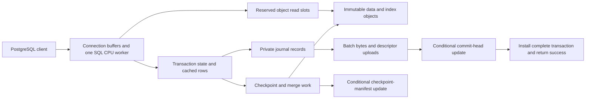

# How pos3ql works

pos3ql serves PostgreSQL SQL and protocol clients while saving durable state in
an S3-compatible object store. A configured object prefix contains one pos3ql
instance's durable state, including its SQL databases. One active process owns
the right to publish changes to that prefix. This is a single active writer
process, not a rule that every storage request must run in sequence. Ownership
is a conditional writer-fence object, not a time-based lease: a replacement
process fences the old one, whose next publication fails. There is no read-only
shared-snapshot protocol for other processes reading the same prefix.

**Example:** the same instance can contain `orders` and `billing` databases.
Their tables use the same startup memory budget and object-store namespace.
A backup or writer replacement concerns that namespace; creating a SQL database
does not create an independently operated storage service.

Startup may take exclusive recovery ownership before validating the remaining
journal. This prevents the previous writer from publishing while recovery runs;
a failed recovery can therefore leave that writer fenced out. The new process
accepts SQL writes only after journal replay and restored definitions validate.

## The request path

Connection input, parsed SQL, statement workspaces, transaction undo, locks,
object requests and output each have a fixed reservation made at startup. After
startup, ordinary runtime work cannot grow a heap, pool or sort allocation; the
isolated TLS transport uses its own separately budgeted pool. The memory plan
covers these reservations only, not total operating-system RSS, kernel socket
memory or the object-storage service. See
[memory and physical size](#memory-and-physical-size).

### Execution model

A **reactor** is the event loop that waits for socket readiness and deadlines.
Each turn it advances ready connections and a bounded amount of maintenance,
then registers newly opened storage sockets before sleeping, so cleanup keeps
moving on an idle server.

All SQL CPU work runs on **one SQL CPU worker**. Adding connections or
`query_workspace_slots` adds concurrent sessions and workspaces, not CPU
execution workers ([several workers are planned](../PLAN.md#run-sql-on-several-cpu-workers)).

When a command needs an object that is not cached, it can **yield**: it keeps
its read requests, data owners and original command deadline, and the worker
runs another connection's cached work until the download arrives. A path that
cannot yield **blocks**: the read completes synchronously and occupies the
worker. Completion or failure releases unused read-ahead requests; commit does
so as soon as its row images are in the journal, so an abandoned speculative
download cannot hold up the next checkpoint. Lock waits are separate: a
command waiting for a row, table or advisory lock parks with its saved state,
including inside procedural code, and the worker runs other connections.

**Effects.** A statement can restart freely until its first **effect**,
something a restart could not undo or repeat: calling a volatile function or a
user routine body, `nextval`/`setval`, or output reaching the client. The
sections below say how each path keeps its progress past that point; the
[table](#what-pauses-today) summarizes them.

**Restarts always finish.** A restarted statement reads its blocks again and
finds earlier downloads only in the block or disk cache. It reruns only once
one of its own reads has completed (another session's read does not wake it).
Per statement, the read path counts how often it downloaded each block since
the statement last kept progress (rows a resumed write kept, a delivered
result row). An attempt that would download a block a third time, or one more
distinct block than `statement_restart_waits` (default 64), reads the rest of
the statement synchronously. So with `block_cache_bytes = 0` and
`disk_cache_bytes = 0`, `SELECT ... UNION ALL ...` over three cold tables waits
a few times and then finishes.

#### Writes

**Row selection restarts.** `INSERT ... SELECT`, `UPDATE`, `DELETE` and
`MERGE`, at top level or in a `CALL` or `DO` body, first select (and for
`UPDATE` and `DELETE`, lock) their rows. Nothing has changed yet, so a cold
read or row lock wait in this phase rolls the statement back to its start and
yields; on resume it sees the rows as of its new start, as PostgreSQL would
had it started then. A sequence or routine call in the scan is an effect as
usual, so a `BEFORE STATEMENT` trigger makes the whole scan synchronous.

**Row changes resume at their row.** Once a write changes rows, a storage or
lock wait rolls back only the unfinished row (with its trigger writes and
output). The write keeps its progress (the unfinished row, finished steps, the
routine-call log and sequence replay) on the transaction, or for a write in a
`CALL` or `DO` body on the procedure frame. The next attempt selects its rows
again under the same command and snapshot, skips the changed ones and
continues at that row; sequence values and routine results replay from the
statement's log, so each happens once. An effect a rerun would not repeat
identically (a volatile built-in such as `random()`, an advisory lock, output
that reached the client) makes the rest of its row read synchronously; one in
the scan makes the write read all its rows synchronously, and a lock wait then
runs it again from its first start. A wait inside a routine body run for a row
continues that body.

**Example:** `UPDATE orders SET status = 'late' WHERE due < now()` over cold
`orders` yields while it downloads the blocks it scans, and the rows change
once. `INSERT INTO order_lines SELECT ... FROM staging`, where each line's
foreign key check reads a cold `products` block, yields at each such row; the
rows before it stay inserted, and their serial defaults and trigger audit rows
happen once.

**Routine calls run between attempts.** A row expression, row trigger or
`RETURNING` item (including `MERGE`'s join condition) that calls a PL/pgSQL or
data-modifying function ends the write attempt, because the call runs on the
engine. Before the first row change the attempt rolls back and runs again,
replaying the call's saved result; after it, the write keeps its changed rows,
the call runs and sees them, and the next attempt continues at the unfinished
row or its `RETURNING` values. So `UPDATE items SET total = running_total()`,
where `running_total()` sums `items`, gives each row the sum including the
rows updated before it, as in PostgreSQL. Queued `AFTER` row events belong to
the statement that queued them (its nesting depth and command), so they fire
when the write ends. `BEFORE` and `INSTEAD OF` trigger bodies that reach work
only the engine runs (DDL, a write to a view or a table with rules, a routine
call) become the pending call the same way: the engine runs the whole body
once and the invocation log keeps whether the row is kept and the `NEW` row it
returned. Writes in a body run on the engine, and writes of a PL/pgSQL or
SQL-language function called from a query (`SELECT f()`), hand their `AFTER`
triggers to the engine too. A wait inside such a call restarts the whole
statement; an error inside it rolls the statement back.

**Multi-step writes keep finished steps.** A data-modifying `WITH` and its
main statement, or a rule's original statement and actions, save each
finished step's output rows and row counts; the next attempt skips them and
the unfinished step continues at its row or from its own start. A multi-step
statement inside another's step keeps its steps one level deeper, up to
`write_step_levels` levels (default 4); deeper fails with `54000` naming the
setting. A step that changed rows without row progress fails a later call
with `0A000` rather than hide those changes behind a rollback. A write to a
foreign table, or to a partitioned or inherited table with foreign children,
keeps its selected rows instead of selecting them again, since the remote
session keeps the earlier changes.

**`INSERT ... SELECT` streams a repeatable source.** A source that calls no
volatile built-in and no user routine, and that a retained reader runs (see
[retained plan tree](#retained-plan-tree)), reads as of the statement's
start and holds one source row at a time in a fixed 512 KiB block of the
arena (with less than 1 MiB free, the source materializes instead). Each row
is written before the next is read, so `INSERT INTO archive SELECT * FROM
orders` copies any number of rows in fixed memory, and a source reading its
own target sees none of the new rows. A restart skips, by count, the rows
earlier attempts wrote. A source whose volatile built-ins are all in its
output list (without ordering, grouping, `DISTINCT`, windows, set operations
or row locking), or that reads a data-modifying `WITH` query, is read by the
engine one row at a time as PostgreSQL's ModifyTable pulls it
(`src/sql/driven_insert.rs`); a call waiting inside its body keeps the shared
invocation log in the write's progress (leased from `execution_control_bytes`
while it waits). A source calling a user routine otherwise materializes in the
work arena (`54000` when larger); an output item calling a volatile user
routine then runs as each row is inserted.

#### AFTER events

Every queued `AFTER ROW` and `AFTER STATEMENT` trigger, constraint trigger,
foreign key check and referential action is a record in the transaction's
event log, fired at its statement's end (or at `SET CONSTRAINTS` and commit
when deferred), as PostgreSQL's after-trigger queue does. A row's foreign key
events take their places among its `AFTER` triggers by the names of
PostgreSQL's `RI_ConstraintTrigger_c_<oid>`/`_a_<oid>` triggers, and a
possible conflict of a deferrable unique or exclusion key queues its recheck
as `PK_ConstraintTrigger_<oid>` or `Unique_ConstraintTrigger_<oid>` (the
constraint's OID). A referencing check reads the row's current version; a
referenced check carries the old key, and `NO ACTION` passes when another row
provides that key again.

A `CASCADE`, `SET NULL` or `SET DEFAULT` action runs PostgreSQL's
`ri_triggers.c` query through the nested write path as the child's owner, so
rules rewrite it and the child's `BEFORE` triggers fire. Its events, like a
data-modifying `WITH` sub-statement's, join the end of the statement's queue
(`AfterEventOwner`), and per statement, table and operation each `AFTER
STATEMENT` trigger fires once after the last change with all transition rows
(PostgreSQL's `AfterTriggersTableData`). So `WITH d AS (DELETE FROM p ...)
INSERT INTO p SELECT ...` passes as in PostgreSQL.

The log is cut into 64 KiB pages: `deferred_trigger_bytes` of them stay in
memory per connection and older pages move to the `trigger_event_spill_bytes`
file shared by all connections, recreated empty at startup. Only when both are
full does queuing fail with `54000`. A fired event records the number of its
firing, so a rollback to a statement or savepoint re-arms exactly the events
fired after it.

**AFTER work resumes.** A top-level write, and a write in a `CALL` or `DO`
body, keeps its finished `AFTER` work across a wait: queued events in order,
with immediate constraint checks (deferrable unique and exclusion constraints
in `IMMEDIATE` mode) before its first `AFTER STATEMENT` trigger and again after
any events queued later. A wait inside a PL/pgSQL trigger body continues at
its waiting statement; one before the body starts runs the same event again,
replaying its sequence values. Each event's reads yield until its own first
effect, after which the rest of that event reads synchronously. A top-level
rule-rewritten write runs each step under its own completion boundary, so its
steps' `AFTER` work yields too and the next attempt skips finished steps,
replaying both invocation logs and the sequence replay from the last finished
step. Rule steps inside a routine body run their `AFTER` work inline and
synchronously. Cancellation, a timeout, an error and the end of the
transaction release kept progress.

Write completion follows PostgreSQL's
[write executor](https://github.com/postgres/postgres/blob/REL_18_STABLE/src/backend/executor/nodeModifyTable.c):
`AFTER STATEMENT` triggers queue after the row events (`MERGE` queues them in
`DELETE`, `UPDATE`, `INSERT` order; `INSERT ... ON CONFLICT DO UPDATE` queues
`UPDATE` before `INSERT`), the queue drains, then one completion returns.
Nested writes inside a trigger hand their `AFTER` work to the calling trigger.

#### Results

**The worker never waits for a client.** A result larger than the
connection's send buffer (`conn_send_buffer_bytes`) queues in the shared
result spool (`result_spool_bytes` / `result_spool_leases`); a private reserve
the size of the send buffer always holds the closing `CommandComplete`,
`ErrorResponse` and `ReadyForQuery`. Socket writes are non-blocking for
plaintext and TLS. A slow client's statement still finishes, and the
connection then waits for the client before processing its next message
(pipelined messages wait in order). A client further behind than the spool
receives the rows already queued, then `54000` naming `result_spool_bytes`; its
session stays usable (an implicit transaction rolls back, an explicit one
becomes failed). Notifications are held while a result is in progress.

Bytes leave during a statement only where no object-store publication can
follow: in local mode, and for a lone `SELECT`, `SHOW`, `VALUES` or `TABLE` in
object-store mode until it starts an effect. Other output waits for durable
publication. An attempt that called a SQL-language routine may still replay,
so its rows stay queued until it finishes; if such a routine is first called
after rows reached the client, the statement fails with `0A000` instead of
repeating them.

**Result streams resume row by row.** Before a top-level `SELECT` or `COPY ...
TO STDOUT` runs, the engine decides whether it can become a **result
stream**: a query a [retained plan tree](#retained-plan-tree) can read whose
read position (one record per resident row of each table plus the query text)
fits `result_stream_bytes`. If its output first outgrows the send buffer
before any byte left and before any effect, that attempt is discarded and the
statement reopens from a retained read position. It then delivers rows as the
client reads them and yields when the client is behind (`Client`/`ClientWrite`
in `pg_stat_activity`), when a row waits for an object download, and when a row
waits for a lock. Delivered rows are final: a wait inside a row re-evaluates
only that row, and an effect makes only the rest of that row read
synchronously. A delivered row's receipts are released before the next row,
so memory holds one row's receipts however long the stream runs.

Every other large result spools, decided before any of its rows reach the
client; `pos3ql_result_stream_spooled_total` counts those by reason (`shape`,
`capacity`, `effects`). A spooled result yields on cold storage only until its
first byte reaches the client, then reads synchronously. That covers shapes
no retained tree reads yet, sorted results in object-store mode, row locking,
row security, a result that started an effect before it overflowed, and a
`FETCH` from a scrollable cursor that saves its history. A statement that does
not stream restarts from its start after each cold read.

**Paged portals.** An `Execute` with a row limit opens a streamable
statement's stream before running it, so a sort, grouping or hash table is
built once and its input reads resume instead of restarting. Each `Execute`
evaluates only the rows it returns, then the portal suspends with
`PortalSuspended`, keeping its read position and snapshot while other
statements of the transaction run. A connection has `result_stream_slots`
stream allocations: a running stream uses one and each suspended portal keeps
one. When all are held, other large results spool for `capacity`, and another
paged portal buffers its whole result in `portal_result_bytes` (`54000` naming
that setting when full), as do paged portals of other shapes; a buffered portal sends nothing before
its first page, so its reads yield throughout. DDL on a table a
suspended portal reads fails with `55006`, as in PostgreSQL. Under the other
protocols a join or grouping runs in the general executor first and streams
only once its output overflows.

**Cursors.** A forward `FETCH n` or `FETCH ALL` (simple Query or unpaged
`Execute`) from a cursor that reads as it fetches and saves no history streams
over the cursor's own retained query: no row is saved in `cursor_bytes`, and
a failure after delivered rows marks the cursor failed, as PostgreSQL does. A
cursor saves no history when it is `NO SCROLL` or forward-only, or scrollable
but unordered, not locking and free of volatile functions: backward motion
then rewinds its retained input to the first row under the same snapshot and
reads forward, so memory stays fixed. Scrollable cursors that evaluate
revisited rows again, or that sort or lock, save every visited row in
`cursor_bytes`. A cursor over a retained join is `NO SCROLL` unless declared
`SCROLL`, as PostgreSQL's join plans cannot scan backward; a `SCROLL` join
cursor with a volatile output list or filter saves its output rows, as
PostgreSQL's Material node does.

**Example:** `SELECT id, payload FROM orders` sent by a client on a slow link
delivers rows as the client reads them; while it waits for the client or a
cold block of `orders`, other connections run. In object-store mode `SELECT
... FROM orders ORDER BY id` sorts first, so its output queues in the spool.

#### What pauses today

| Path | Cold storage read |
|---|---|
| Queries before their first effect, including reads inside explicit transactions | Yields |
| Journal uploads and the commit's wait for its durable receipt | Yields |
| Maintenance: checkpoint capture, merges, index builds, journal and saved-file cleanup | Yields, using a separate maintenance read owner and fixed clients |
| A statement after its first effect (volatile function, routine body, sequence change, first output byte reaching the client) | Blocks until the statement ends |
| Output queued for a slow client | Never blocks; the connection waits for the client between messages |
| Result streams, including `COPY ... TO STDOUT` and a streamed `FETCH`: each row before its first effect | Yields; delivered rows are kept |
| Writes (`INSERT ... SELECT`, `UPDATE`, `DELETE`, `MERGE`, data-modifying `WITH`), also in a `CALL` or `DO` body: selecting and locking rows before the first row change, `VALUES` row or trigger body | Yields; the statement restarts from its start |
| Writes after their first row change, also in a `CALL` or `DO` body: each row's index maintenance, constraint checks, trigger bodies and `RETURNING`, until an effect a rerun would not repeat identically | Yields; only the unfinished row rolls back |
| A write's row after an effect a rerun would not repeat, or every row when such an effect ran in its scan | Blocks until the next step's rows or the statement's end |
| A top-level write's `AFTER ROW` events, immediate constraint checks and `AFTER STATEMENT` triggers | Yields; finished events are kept. An event's reads after its first effect block until that event ends |
| A rule action's row selection after the rule's earlier steps, when their rows could resume | Yields; the step rolls back to its start and the finished steps are kept |
| `AFTER` work of a top-level rule-rewritten write's steps | Yields; finished steps and events are kept |
| A data-modifying `WITH` main statement's row selection; `AFTER` work of writes inside routine bodies | Blocks until the next step's rows or that work ends |
| Routine calls inside a write's rows (`INSERT`, `UPDATE`, `DELETE`, `MERGE`, data-modifying `WITH`, rule actions, `INSTEAD OF` view triggers): row expressions, row triggers, `RETURNING`; `BEFORE` and `INSTEAD OF` trigger bodies that need the engine | Run on the engine between attempts; the write keeps its changed rows and finished steps. A storage or lock wait inside the call restarts the whole statement |
| DDL and `COPY FROM` | Blocks for the whole statement |
| Top-level `CALL` and `DO` bodies: queries and write scans before the statement's first effect | Yields; the body resumes at its waiting statement |
| Statements after the first effect inside a `CALL` or `DO` body | Blocks |
| PL/pgSQL `OPEN`, `FETCH` and cursor `FOR` loops reading cold rows (a lock wait parks) | Blocks |
| Commit processing, deferred constraint triggers, `SET CONSTRAINTS`, `PREPARE TRANSACTION`, `COMMIT PREPARED`/`ROLLBACK PREPARED` | Blocks |
| `COPY FROM` rows and completion; a `COPY TO` that cannot stream once its first byte reaches the client; logical-replication apply and initial copy | Blocks |
| Large-object fast-path calls, login event triggers, manual `CHECKPOINT` | Blocks |

Converting the blocking paths is tracked in
[PLAN.md](../PLAN.md#pause-and-resume-every-query-path).

**Example:** while one connection waits for a cold `orders` column, another
connection's cached lookup and a third connection's commit can finish. Had
the first statement already called `nextval('order_ids')`, its remaining
reads would instead block the worker.

### Retained plan tree

A result stream, a retained cursor and a top-level `SELECT` run in place read
their rows through a **plan tree** of nodes that each produce one row at a
time and keep their position between rows: a leaf (a table scan, literal
list, generator calls, a FROM-less row, or a join), an optional filter, sort or
grouping, the projection and the limit. Each node is a fixed record inside the
reader, which lives in the stream's `result_stream_bytes` allocation or the
cursor's slot; sorts, groupings and hash joins keep their rows in
`plan_build_bytes` leases. Every node can advance, expose its current row,
release it, and rewind for a scrollable cursor. A wait inside any node returns
to the driver with every node's state kept, and the same step resumes. The top
filter, projection and limit run in the statement driver, so a routine call
there hands off on its row (`src/sql/query/retained/tree.rs`). A node never
repeats an effect: row receipts stay with the row being built and are released
when it is delivered.

No reader keeps a `Storage` borrow between calls: each call passes the
storage, and a reader's type does not carry its lifetime, so the compiler
rejects a node or scope that would keep one. A reader keeps only its
subqueries' cached values, and a data change's subqueries run through the
storage of the catalog evaluating them.

**Joins.** A plan PostgreSQL's join search chose runs as pull nodes unless
it scans a `LATERAL` item;
[query planning](query-planning.md#pull-based-join-executor) describes them
and which statements still run plans in the general executor. Other
joins of up to eight FROM items (tables, generator calls or `VALUES` lists)
read through the retained reader's own levels, in the general executor's
order (FROM order, or its cost order for a cross join):

- A **nested loop** keeps per level its source position, its current row
  (nested in the allocation like a stack, so finishing a row releases exactly
  its bytes) and, for a `LEFT JOIN`, whether the row above found a partner;
  an inner level rewinds for each row above. `ON` and error-safe `WHERE`
  conjuncts run at the first level where their tables are bound. A `RIGHT`
  or `FULL` join of two items keeps one flag per right row in a
  `plan_build_bytes` lease and returns the unmatched right rows after the last
  left row. A `FULL JOIN` without an equality between the two sides fails with
  `0A000`, as PostgreSQL plans it only as a merge or hash join.
- A **hash join** is used where the general executor would hash, building the
  same side at the join's first row (a declared cursor's at `DECLARE`) into
  three `plan_build_bytes` leases: bucket heads sized from the planner's
  estimate, entries, and the rows in projected encoding. A wait during the
  build keeps the rows read so far. A preserved build side keeps its NULL-key
  rows and a match flag per entry, and returns its unmatched rows after the
  last outer row. A cursor moving back rereads only its outer table.

Admission reuses the general planner's choice, so streaming never turns a
hashed or indexed join into a full nested loop; a join the general executor
would probe through an index per outer row spools for `shape`.

**Grouping.** A stream or top-level `SELECT` run in place (not a declared
cursor) groups a single source or retained join when its keys, `WHERE` and
aggregate inputs are non-volatile and call no SQL-language routine, custom
aggregates' support functions are built-in (in object-store mode, also not
combined in parts), and any `ORDER BY` is an ascending, NULLs-last prefix of
its keys; without grouping sets or `DISTINCT ON`. A plain `SELECT DISTINCT`
groups by its output list the same way, each value keeping its first row's
spelling (`1` before `1.00`) as PostgreSQL's hashed `DISTINCT` does. At its
first row it reads its whole input. The input is saved:

- **per group** when every transition state has a fixed size or holds one
  value (`count`, `sum`/`avg` over integers, `money`, floats and `interval`,
  `min`/`max`, `bool_and`/`bool_or`/`every`, bitwise aggregates over integers,
  variance and standard deviation over floats, the two-argument statistical
  aggregates; no `DISTINCT` or aggregate `ORDER BY`): each group keeps its key
  and states in `plan_build_bytes`, found through a balanced tree, so `SELECT
  k, count(*) FROM t GROUP BY k` holds one record per distinct `k`;
- **per input row** otherwise: each row's keys and aggregated columns, ordered
  by key (stable), then each group's keys and results.

Groups come out in the general executor's order (keys ascending, NULLs last).
`HAVING` and the output list run per group as its row is returned. An error in
an aggregate's input is reported before the first row; one in a result,
`HAVING` or the output list follows the groups already returned, as
PostgreSQL's executor returns them. A top-level `SELECT` runs in place only
when its output list, `WHERE` or `HAVING` may hand a call off to a routine;
`SELECT count(*) FROM t` stays in the general executor.

**Sorts (local mode).** At its first row a sort reads and filters its whole
input and saves each row's sort keys, the output items that run before the
sort and, when a volatile item runs after it, the row's input columns, in two
`plan_build_bytes` leases. It orders them with an in-place heap sort (equal
keys keep input order); a volatile item runs as its row is returned, so
`nextval` numbers rows in output order. Sort keys, the filter and items run
before the sort must be non-volatile and call no SQL-language routine; with
`LIMIT` or `OFFSET` those items must be columns or constants. `DISTINCT ON`
sorts by `ORDER BY`, then its remaining expressions ascending, and returns the
first row of each run. In object-store mode the general executor sorts in
external runs on the block grid and the result spools; the choice never
depends on input size.

**`UNION ALL`.** A stream (not a declared cursor) reads a `UNION ALL` as
PostgreSQL's Append node does, each query with its own plan, read to its end
before the next starts, its values coerced to the combined column types. Every
query's expressions must be non-volatile and call no routine body, and the
physical tables of all queries together are limited to eight. Every protocol
opens it before running, since the general executor would materialize every
query before its first row could overflow.

**Opening and capacity.** Eligibility and the reader share one admission
function, decided from the query's shape before it runs, and promotion never
makes a result fail that would have spooled. A stream holds its opening
messages (RowDescription, or CopyOutResponse and a COPY header) in a 16 KiB
part of `result_stream_bytes` until its first row is prepared. If opening or a
build fails for capacity (`54000`: `result_stream_bytes`, the opening messages
or `plan_build_bytes`), nothing has been queued, so the statement runs again
with its output spooled, counted under `reason="capacity"`; a rerun that waits
for storage spools again rather than promoting. Any other build error follows
the opening messages, as PostgreSQL sends them first. A declared cursor whose
build does not fit at `DECLARE` saves its rows in `cursor_bytes` instead.

**Query rewriting before planning** (shared by streams and the general
executor):

- *Aggregate levels:* each aggregate call belongs to the innermost query whose
  columns its arguments read, so `SELECT (SELECT max(t.id) FROM u) FROM t`
  aggregates `t` and returns one row; placement errors (an aggregate in
  `WHERE`, `JOIN ... ON`, `GROUP BY`, ...) are reported before any row is read
  (`src/sql/query/aggregate_levels.rs`).
- *Subqueries in FROM* are merged into their query when exact, as
  `pull_up_subqueries` does, so `SELECT * FROM (SELECT 10/x AS q, x FROM t) s
  WHERE x <> 0` filters before it divides and an unread output is never
  computed. Not merged: grouping, aggregates, windows, `DISTINCT`, `ORDER BY`,
  `LIMIT`, locking, set-returning or volatile output, security-barrier views,
  names the merge could rebind, and under a nullable outer join, a `WHERE` or
  outputs that are not null whenever their columns are. A view merges when the
  caller holds `SELECT` on all of it. Outer `WHERE` conjuncts reading only a
  kept subquery's columns are pushed into it under the view-filter safety
  rules, and `HAVING` conjuncts without aggregates, volatile calls or
  subqueries move into `WHERE` (`src/sql/query/pullup.rs`).
- *CTEs and views* expand as in the general executor. A CTE is inlined when it
  is not recursive, data-modifying, `MATERIALIZED` or volatile and is read
  once (or is `NOT MATERIALIZED`); one nothing reads never runs. A query with
  a CTE that must run once, or a view the caller may read only in part,
  spools for `shape` (`src/sql/query/cte.rs`).

**Subqueries.** An uncorrelated scalar, `EXISTS`, `ARRAY`, row or
`IN`/`ANY`/`ALL` subquery that calls no volatile or user-defined function runs
when an expression first reads it, as PostgreSQL's initPlans and hashed
subplans do, and keeps its value for the statement (in `result_stream_bytes`
or the statement arena's persistent tail); a list keeps its members as encoded
rows or, in object-store mode, an external run. So `SELECT (SELECT 1/x FROM
z) FROM empty_table` returns no rows (`DeferredSubquery` in
`src/sql/eval/mod.rs`). A `WHERE` conjunct reading no column of its query runs
once before the scan, as PostgreSQL's one-time filter. A data change's
subqueries read as of its command (`DmlSubqueries`). A subquery nested in a
query that runs per row (a correlated or `LATERAL` subquery, a set-operation
branch, a function in `FROM`) has a slot in the persistent tail, so `SELECT
(SELECT x + (SELECT nextval('s')) FROM z WHERE x <= t.id) FROM t` calls
`nextval` once.

A correlated subquery is bound once per statement against its outer rows'
types (`SubqueryBinding`); one nested in a per-row query is bound at its first
run in a fixed 64 KiB workspace of the persistent tail (`NestedBindings`),
whose exhaustion fails with `54000`. It runs only when evaluation reaches it
(`CorrelatedSubqueries` in `src/sql/query/subquery.rs`), so a `CASE` branch or
`COALESCE` argument not taken never runs its subquery. Correlated subqueries,
and subqueries in a `UNION ALL` or a declared cursor, still spool or save
their rows.

Every other shape runs in the general executor, which materializes in the
statement arena and cannot pause after its first byte.

**Node summary**

| Node | State it retains | Memory owner |
|---|---|---|
| Scan (table, literal list, generator calls, FROM-less row) | Read position and current row | Stream or cursor allocation |
| Filter, projection, `LIMIT`/`OFFSET` | Condition, items, remaining counts | Node record |
| Join-search pull nodes | See [query planning](query-planning.md#pull-based-join-executor) | `plan_build_bytes` |
| Retained nested-loop join (inner, cross, `LEFT`; `RIGHT` and `FULL` of two items) | Each level's row bytes, position and matched flag; a flag per right row for `RIGHT`/`FULL` | Stream or cursor allocation; right-row flags in `plan_build_bytes` |
| Retained hash join (two tables, every join type) | Build rows, entries and bucket heads; a match flag per entry when the build side is preserved | `plan_build_bytes` / `plan_build_leases`; exhaustion is `54000` naming them |
| Grouping and plain `DISTINCT` | Each group's key, states and held values; or every input row's keys and columns, then each group's results | `plan_build_bytes` |
| Hash aggregate (general executor: a one-table hashed `DISTINCT`, and the order of hashed groupings) | PostgreSQL's `simplehash` buckets, each group's row of the current batch, spilled rows in 8 kB tape blocks a read batch frees for reuse | `plan_build_bytes`; exhaustion is `54000` naming it |
| Sort (local mode, also `DISTINCT ON`) | Sort keys, saved output and input columns of every row | `plan_build_bytes` |
| `UNION ALL` | Each query's plan and the current query | Stream allocation |
| Uncorrelated subqueries | Each value, or a list's encoded rows or external run | Stream allocation or persistent tail |

### Write sub-statements that run as their rows are read

PostgreSQL runs a data-modifying `WITH` query, a rule's action and an
`INSERT ... SELECT` source as plan nodes the consuming statement pulls rows
from, so their row triggers, calls and sequence values interleave with the
consumer's. `WITH w AS (INSERT INTO a ... RETURNING x) INSERT INTO b SELECT x
FROM w` queues `a`'s row 1, `b`'s row 1, `a`'s row 2 and so on, and `a`'s
statement event once `b` reads past `w`'s last row.

A data-modifying `WITH` query is bound as a relation whose rows live with the
statement's invocation log (`WriteProducer` in `src/sql/query/mod.rs`). A
reader pulling rows one at a time reads it through a retained scan node
(`RetainedSource::Produced`): a row past those the query returned makes its
next step the attempt's pending call, which the engine runs between the
reader's rows. An `INSERT ... SELECT` step reads its source through an
engine-driven retained reader (`src/sql/driven_insert.rs`) and writes each row
by its own call of the insert (`InsertSource::Produced`); an `UPDATE`,
`DELETE`, `MERGE` or `INSERT ... VALUES` step ends at the start of the row
after one that returned a row, as ModifyTable returns each row first. The
reader and analysed statement live in a 512 KiB block of the statement arena's
persistent tail; each attempt's work is reclaimed, so memory does not grow
with the rows.

Readers that pull row by row: a `SELECT` whose single `FROM` item is such a
query (or a `UNION ALL` of such `SELECT`s) when it calls routines or when
partial reading is visible (`LIMIT`, `OFFSET`, several readers); an `INSERT
... SELECT` step reading another; and a top-level `INSERT ... SELECT` reading
one. After the main query every data-modifying query runs to its end, last
first, as `ExecPostprocessPlan` does. Sort, aggregate and window readers read
their whole input first, as PostgreSQL's do; a join reader reads the query
whole at its first read, which matches PostgreSQL only when its plan hashes
the query. A wait inside a step runs the statement again from its first start.

### How saved state is owned

A paused command must resume exactly where it stopped, without repeating
effects. The general rule: **everything needed to resume moves out of
temporary statement memory into a startup-reserved owner before the command
pauses**, and every completed effect leaves a **receipt** that resumption
replays instead of running the effect again.

| Saved state | Owner |
|---|---|
| Procedural positions, lexical frames, source images, resolved local declarations, loop scopes, named-output bindings, caught error text | `execution_control_bytes` / `execution_control_leases` |
| Saved local values, trigger `OLD`/`NEW` rows and arguments, transition tables, loop inputs, set-returning results, `EXECUTE ... INTO` results, finished expression values of a waiting statement | `row_work_bytes` / `row_work_leases` |
| Completed function results, argument values, selected functions and casts, sequence and advisory-lock receipts | The statement arena's retained region (the invocation log), within existing statement capacity |
| Checked literal inputs saved with routines and stored definitions | `table_metadata_bytes` / `table_metadata_leases`, with `routine_input_slots` control records |
| Execution schemas | `definition_image_slots` |
| Result output queued for a slow client | Rows: `result_spool_bytes` / `result_spool_leases`, released as soon as the client drains them. Closing messages: a private reserve of `conn_send_buffer_bytes` per connection |
| A result stream's query text, parameters, row positions and saved-file readers | `result_stream_bytes` per stream, `result_stream_slots` streams per connection; released at completion, error, cancel, timeout or disconnect, and for a paged portal when the portal is closed or rebound or its transaction ends. Not visible in `pg_cursors` and not counted in `max_cursors`. A streamed `FETCH` keeps its rows' state in its cursor's own allocations |

Further rules that apply to every saved owner:

- **Environment.** A paused call saves its search path, settings, effective
  user, statement and transaction timestamps and original deadline, and
  reinstalls them on resume. Another connection cannot lend it settings or
  renew its timer. A failed reattachment restores the caller's environment.
- **Identity checks.** Saved state records its connection, database,
  transaction, command and arena. Resuming under a different owner fails with
  `40001` or an internal error before changing any state, and leaves the saved
  state intact.
- **Receipts.** For example, a function that writes an audit row, issues an
  order number, then waits for an advisory lock resumes with the same local
  values and writes that audit row once. `PERFORM write_audit('one'),
  wait_for_lock(), write_audit('two')` inserts each row once even if the lock
  waits repeatedly; a second lock call in the same statement reuses the first
  call's receipt instead of taking another hold.
- **Unsupported restarts fail loudly.** A path that cannot save its progress
  returns `0A000` and rolls back rather than repeat a write — for example
  `SQL row expression requires retained write progress` for a routine call
  after a SQL-language function's `MERGE` or data-modifying `WITH` changed
  rows; or an unsaved volatile
  value such as `random()`. Contexts with no resumable executor reject advisory
  unlocks with `0A000`.
- **Typed wait markers.** Internal waits use a typed marker, not a SQLSTATE.
  An application raising `PZ001` returns or catches it normally; it cannot park
  a connection.
- **Exhaustion.** A full pool returns `54000` naming its settings. Growing a
  saved buffer reserves its replacement first, so failure keeps the previous
  value readable.

A top-level `CALL` or `DO` keeps its waiting PL/pgSQL body on the
transaction: lexical position, local values, settings, timer and journal
position, in the same pools as a saved function. A nested `CALL` keeps the
callee's body in its caller's saved frame. Each body statement is its own
rollback boundary: a write that waits for a row lock rolls back only itself
and runs again on resume, so the body can wait after its own `COMMIT` or
`ROLLBACK`, which start new transactions without ending the statement or its
effect journal. Ending the statement by error, timeout, cancel or disconnect
releases the saved body.

With `track_functions = 'all'`, an active function timer owns one of 1,024
entries on the SQL execution thread. A paused call releases its entry and
re-admits it on resume, so another client's calls are not counted as its
children. Exhaustion returns `54000` naming the function timing stack.

### Stored expressions

PostgreSQL stores a CHECK constraint, an exclusion constraint's elements and
predicate, a column default or generation expression, and an index key
expression or predicate as an analyzed tree that
names functions, operators, types and collations by OID. pos3ql stores the
SQL text and, beside it, the dependency list captured when the expression was
written: each entry pairs the spelling used with the object it resolved to
under the creator's `search_path`. Before an expression runs, is printed
(`pg_get_constraintdef`, `pg_get_expr`, `pg_get_indexdef`, `\d`) or describes
a key, its text is bound to those objects under their current names. So with
`search_path = app` at creation, `CHECK (score(a) > 0)` keeps calling
`app.score` after the path changes, after `ALTER FUNCTION app.score RENAME TO
rank` (printed as `app.rank(a)`), and after `ALTER SCHEMA app RENAME TO core`.

| Owner | Where the list lives | Limit |
|---|---|---|
| CHECK and exclusion constraints, defaults, generated columns | The table definition, frozen into `table_metadata_bytes` | 64 entries per table |
| Index keys and predicate | The index definition | 16 entries per index |

Each single expression also respects `max_stored_query_dependencies_per_object`.
Exceeding a limit returns `54000`. Sequence references are not in the list:
`nextval('s')` keeps its regclass literal, which sequence renames already
maintain.

The lists produce `pg_depend` rows as PostgreSQL's do: a constraint, default
or index depends normally on what it names, and a generation expression
internally on its column. `DROP ... RESTRICT` of a named object therefore
fails listing them, and `CASCADE` drops the CHECK and exclusion constraints,
clears the defaults, drops the generated columns and drops the indexes (after
the drop that removed the object, in one statement). An exclusion
constraint's index likewise depends on a user-defined operator class it uses
and the constraint on a user-defined operator it compares with. A partition's
or `LIKE` copy's constraint keeps its source's list. Statistics expressions,
trigger conditions and domain constraints still store plain text; renaming
or moving a routine or type one of them names is refused with `0A000`, and so
is renaming an enum label any stored expression spells.

### Catalog reads within a statement

PostgreSQL reads every catalog relation a statement scans under the
statement's snapshot, so `SELECT mk(g), (SELECT count(*) FROM pg_class) FROM
generate_series(1, 3) g`, where `mk` creates a table, counts the tables that
existed when the statement began. Before a query that calls a user routine
runs, and before any data change, compound query or `WITH` statement runs
(a trigger may change the catalog), pos3ql builds an image of every
`pg_catalog` relation the statement names, directly or through views, in the query workspace's `catalog_image_bytes`
arena, and the query's scans read those images until it ends. A query that
calls no user routine cannot change the catalog while it runs, and builds its
images as it first reads each relation. A volatile routine's statements read
the catalog as it is when they run. A statement pins at most 256 images,
nested routine statements included; that limit or a full arena returns
`54000`.

### Statement preparation

Function calls bind their selected function, argument mapping and declared
types before running arguments, using PostgreSQL 18.6 declarations through
static indexes rather than a growing candidate list. Defaults keep the object
identities captured at creation, so a renamed sequence cannot be replaced by
another sequence with its old name. Planner safety facts cover all 3,397
procedures in the pinned PostgreSQL catalog, including internal ones that are
not callable from SQL;
[source hashes](https://github.com/e6qu/pos3ql/blob/d79ba0232874d6dfbd7a9f7a744af9a9a12f3318/tests/external/reference/2026-11-03-input-plans/planner-procedure-properties.json)
record their origin.

Some literals are checked when SQL is prepared, such as
`'{approved}'::checked_status[]`, where `checked_status` is a domain (a type
with extra constraints). The checked value belongs to the SQL source that
analyzed it:

| Source | When inputs are checked and how long they are kept |
|---|---|
| Simple command | At admission; a new command checks again |
| SQL `PREPARE` or protocol Parse | Once; kept with the statement and its portals |
| SQL function or procedure body | `CREATE` validates; the first runtime call in a backend checks again and the backend keeps the result |
| SQL function considered for inlining | By the caller's planner; kept with the caller's plan if inlined |
| Static PL/pgSQL statement | When first reached; kept by the backend for that definition, input types and collation |
| Dynamic `EXECUTE` | Every execution |
| View, rule, default or `BEGIN ATOMIC` body | With the definition; kept in its immutable metadata image and restored at recovery without re-checking |

`DISCARD PLANS` makes later admissions prepare again; running calls, portals
and cursors keep their checked images. `DISCARD ALL` also releases cached
routine-input plans. Neither re-evaluates inputs saved in schema definitions.
Native regressions in `src/sql/tests/type_input_binding.rs` and
`src/sql/tests/type_input_positions.rs` retain the PostgreSQL 18.6 reference
SQL digests for these distinctions.

Parse, Bind, Describe and `COPY` each restore their own connection's user,
search path, timezone and command timestamps. The original command deadline is
not renewed between protocol messages; an expired Sync still completes error
recovery with ReadyForQuery. Once durable publication starts, a timeout cannot
cancel the required commit receipt.

Leaving a routine configured with `SET` restores only the settings named in that
clause; an explicit session-wide `SET` inside it survives. A connection-wide
64-bit setting counter never wraps; exhausting it returns `54000` with
`session setting assignment counter exhausted`. These rules follow PostgreSQL's
[SET contract](https://www.postgresql.org/docs/18/sql-set.html).

PostgreSQL reference captures for procedural execution:
[nested results](https://github.com/e6qu/pos3ql/blob/main/tests/external/reference/2026-11-06-nested-callback-results/README.md),
[saved output scopes](https://github.com/e6qu/pos3ql/blob/main/tests/external/reference/2026-11-06-saved-output-scopes/README.md),
[name bindings](https://github.com/e6qu/pos3ql/blob/main/tests/external/reference/2026-11-06-procedural-name-bindings/README.md),
[lexical scopes](https://github.com/e6qu/pos3ql/blob/main/tests/external/reference/2026-11-06-procedural-lexical-scopes/README.md),
[parameter scopes](https://github.com/e6qu/pos3ql/blob/main/tests/external/reference/2026-11-06-procedural-parameter-scopes/README.md)
and [caught diagnostics](https://github.com/e6qu/pos3ql/blob/main/tests/external/reference/2026-11-06-caught-diagnostics/README.md).
The [compatibility guide](postgresql-18-compatibility.md) owns the supported
SQL and procedural surface.

### Commit publication

A commit stages private journal records, uploads them, then conditionally
advances the commit head before the transaction becomes visible and the client
sees success; [writes and the success response](#writes-and-the-success-response)
gives the steps. A storage wait during publication resumes that publication; it
never executes the command again. Standalone utilities with an immediate commit
boundary, such as `CREATE DATABASE`, finish durable publication before their
Execute response.

### Catalog history at commit

At commit, `catalog_snapshot::capture_transaction` synthesizes each catalog
relation the transaction's changes can affect twice, as committed and as the
transaction sees it, and records the rows that differ. When every change edits
one table, `reached_tables` limits the per-table catalogs (`pg_class`,
`pg_attribute`, `pg_attrdef`, `pg_constraint`, `pg_depend`, `pg_index`,
`pg_inherits`, `pg_trigger`) to that table's partition or inheritance family
and the tables one foreign key away; other changes compare every table.
`pg_proc` history includes only built-in routines with a per-database entry.
Test builds repeat every selected capture over all tables and fail on any
difference. Committing 300 foreign-key-chained tables' DDL
(`configured_transaction_capacity_covers_truncate_fanout_and_prepared_cold_recovery`,
`native-ci` build) takes 32 s, down from 94.5 s before the selection.

## Reads and storage layout

The durable layout is log structured: new transactions and saved generations
append immutable objects. Small mutable roots identify the committed log and
checkpoint inventory. An object with a content-derived name is never edited in
place. Local RAM and disk accelerate access and can be rebuilt from durable
state in object-store mode.

| Mechanism | What it saves | Example and limit |
|---|---|---|
| Full-slice column groups, called PAX | Downloads for columns that are not needed | Reading `id, status` can skip a large description column; predicates, reconstruction and exact checks can still require more columns |
| Packed, compressed row deltas | Descriptor and column-object overhead for small changes | Updating a few orders writes small row groups rather than a full wide-table slice |
| Eight-byte column extent alignment | Gives encoded column values aligned offsets within packed objects | This is a layout guarantee, not a CPU throughput or sector-size claim |
| Packed objects and verified byte ranges | Request overhead and unnecessary transferred bytes | Several independently verifiable extents can share an object; a ranged GET fetches the selected extent |
| Sparse row indexes and Bloom filters | Reading generations or groups that cannot contain a row | An absent order number can avoid a data read; several generations can still need checking |
| Durable value indexes | Searching unrelated rows or regions | Btree/hash, geometric bounds, interval bounds and GIN postings narrow candidates; exact SQL and visibility checks still determine results |
| Reuse of unchanged immutable groups | Rewriting already saved data | Checkpoint/merge work can reference unchanged PAX groups; changed groups still need output |
| Memory/disk caches and retained reader buffers | Repeated downloads and repeated decoding after a wait | A resumed query retains completed columns and navigation even if the shared cache evicted them |
| Bounded batches of object requests | Serial network round trips | Missing selected columns and independent physical writes can overlap within configured request slots |

These mechanisms are implemented; their production benefit has not been
quantified. PAX is a column-group layout within saved row generations. It does
not imply a separate user-selectable columnar table access method, vectorized
SQL execution, multi-core queries or Parquet compatibility.

An immutable sorted row file, or SST, orders versions by row identity and
commit position. Newer versions are considered before older versions for the
same row. A reader combines applicable saved generations with its resident
changes and deletion markers. Large rows can require an overflow chain;
reading one row is therefore not a fixed number of GET requests.

Joins the [join search](query-planning.md#joins) does not plan run pos3ql's
own order. Two sources joined by up to eight equality keys use a bounded hash
build (fixed 32,768-entry ceiling) over tables, catalogs, derived results and
external sort runs, hashing an outer join's nullable side when it fits, else
its preserved side; other joins, and builds that would not fit, run as nested
loops. A `WHERE` condition is checked at the first level where all its sources
are bound. A materialized source (a catalog relation, CTE or subquery result)
has no index, so a level comparing one of its columns with an earlier source
hashes that column once. Within one statement, a `pg_catalog` base relation is
built once and reused by every scan until the statement writes or changes the
catalog, so psql's `\d`, `\dT` and `\dC` queries do work proportional to their
results rather than to the product of the catalog sizes.

See [index navigation](index-navigation.md) for searchable summaries and exact
checks, and [durable formats](durable-format.md) for encodings and accepted
readers. PostgreSQL's catalog alignment and heap properties describe the SQL
interface; they do not prescribe pos3ql's object layout.

## Writes and the success response

1. SQL checks permissions, constraints and locks and prepares private row and
   catalog changes. Rollback records and journal staging must fit their pools.
2. Before durability, admission reserves replacement table/type definitions,
   index-binding roots and row keys. It retains the completed command while
   required locks or storage are unavailable.
3. A commit captures immutable journal bytes and a descriptor. Independent
   uploads can overlap, and several transactions can share the publication.
4. A conditional update advances the commit head only after the required
   uploads succeed. It preserves the committed predecessor and writer identity.
5. The complete transaction installs in memory, its visible position advances,
   locks release, and the server can send success.

**Example:** updating an order and its invoice in one transaction cannot expose
one changed value and one unchanged value during installation. An older report
can retain its earlier values. A new command waits through the installation
boundary rather than observing half a transaction.

Admission is cancellable before durable publication. A wait preserves
completed defaults, triggers and buffered results; resuming continues the
commit instead of executing the command again. Share relation locks protect
affected tables: ordinary SELECTs and unrelated work can proceed, while
conflicting writes wait. Publication consumes reserved owners rather than
allocating or rebuilding metadata after durability.

After a restart, saved prepared transactions reconstruct their private row and
catalog changes from the journal, including types, indexes and stored queries,
bound in their own database against their own private definitions. Other
transactions still see the committed definitions. `COMMIT PREPARED` completes
admission before making its decision durable, then installs the reserved
changes through normal publication; `ROLLBACK PREPARED` releases them with the
same captured identities and ordinary undo records.

The commit head is ordered because confirmed transactions need one recoverable
history. This does not require serial uploads. More upload slots do not remove
root-update latency or conflicts between transactions updating the same row.

With `object_store = off`, success instead requires local journal durability.
That mode cannot recover lost local-only data from an object store.

No success response crosses the durability boundary. If durable publication
fails, buffered success responses waiting on it are replaced by that error; a
client whose commit was staged instead receives fatal `08007` `commit outcome is unknown;
reconnect before checking it` and its connection closes. With object storage
on, a lost success reply is an uncertain client outcome, not
permission to repeat an external payment blindly.

## Maintenance and scheduling

The server advances checkpointing, file merges, history cleanup, heap relocation
and eligible deletion in bounded turns, between client messages and while idle.
No operating-system cron entry is needed for this internal work. Socket
readiness resumes waiting network requests; owner contention and failed
maintenance retry every second. A quota of 64 visited row slots per turn is a
work bound, not a latency guarantee.

- **Checkpoint:** writes captured committed versions and publishes a complete
  manifest, the inventory of saved objects and definitions. Later commits stay
  in the journal. Finishing an older checkpoint cannot clear newer writes or
  ANALYZE results. Index output is saved only when both its catalog identity
  and its row-decoding context are committed.
- **Merge:** combines saved generations, keeping versions needed by readers.
- **Deletion:** respects current roots, retained readers and backups.
- **History cleanup and relocation:** visit the ordinary shared row pool once
  per pass and the large-object pool separately; a typed cursor reports current,
  skipped-stale or complete positions, and generation checks prevent a reused
  cell from being treated as the earlier row.

Maintenance waits do not block foreground work. Checkpoint row capture, row
output, index input scans, sort-run merges and index output share one
maintenance read owner, reserved in the fixed read pool alongside connections
and subscription workers, with private startup-reserved row and scan buffers.
Journal cleanup and saved-file cleanup each use their own fixed metadata
client, backup list and deletion queue, and keep their listing positions across
waits. Saved-file cleanup validates the complete keep-set before deleting;
durable file writers pause while that decision drains, while foreground RAM
edits continue. A cleanup pass has a fixed cutoff; newer checkpoints queue the
next cutoff instead of restarting it.

**Example:** while an index on saved `orders(customer_id)` waits for storage, a
cached order lookup and another connection's commit can finish. The index
becomes a saved root only after its complete output uploads and the matching
manifest publishes. Replacing its table or changing its inputs abandons the old
job and releases its read request.

`REINDEX` rebuilds from rows, not from the possibly damaged saved index.
`REINDEX TABLE CONCURRENTLY` follows PostgreSQL's phases (commit replacement
entries, wait for earlier writers, build, validate against later writes, wait
for earlier readers, swap, retire and drop); cancellation can leave a
committed invalid replacement or retired index, as in PostgreSQL. A
primary-key constraint keeps its identifier and comment; its backing index
gets a new one. Concurrent rebuilding of an exclusion index is rejected; a
table rebuild warns and skips exclusion indexes and live invalid indexes.
Schema and database rebuilds finish one table at a time. Keys keep the name
chosen at creation (renaming `orders` to `archived_orders` preserves
`orders_pkey`), and changing a table's owner changes its live indexes' owners
in the same transaction. The
[compatibility guide](postgresql-18-compatibility.md) owns the supported
boundaries.

Application jobs, migration scheduling and backup schedules are operator work.
There is no built-in SQL job scheduler or PostgreSQL background-worker ABI.
See [operations](operations.md#scheduled-work-and-schema-migrations) for examples
and [backup rules](backup-restore.md) before scheduling an offline backup command.

## Memory and physical size

Every pool below is reserved at startup and never grows. Exhaustion returns
`54000` naming the pool or its settings, with requested bytes, free bytes, the
largest free extent and remaining lease descriptors where applicable. Byte
pools must be positive multiples of 64; each range rounds up to 64 bytes, and
fragmentation or old/new overlap during a replacement can exhaust bytes or
descriptors independently. File configurations must name each byte/lease pair
explicitly.

### Shared memory pools

| Setting | What it holds | Notes |
|---|---|---|
| `row_overlay_slots` | Resident row metadata for ordinary tables in all databases | Not multiplied by `max_tables`. Saved rows stream from immutable generations; only resident changes, uncheckpointed journal replay and needed history use slots. A write that finds no slot while committed changes await a checkpoint waits for that checkpoint's cleanup (bounded by `statement_timeout`, cancellable), then resumes at its row, including rows an `INSERT` routes to partitions; with nothing to reclaim, or where the statement cannot yield (`COPY`), it fails. A transaction's own uncommitted rows keep their slots until it ends, so a 10,000-row `INSERT` under 8,192 slots fails at once: no checkpoint can free them. In local mode (`object_store = off`) no checkpoint moves rows out of memory, so every row of every table keeps its slot and a full pool fails without waiting |
| `large_object_pages` | The internal large-object table | Separate from `row_overlay_slots` |
| `row_history_slots` | MVCC row history across all tables and large objects | `max_row_versions_per_row` is a separate per-row bound. An update owns its history slot before durability; on pressure, admission examines at most 64 row metadata positions, then waits for a checkpoint as `row_overlay_slots` does, or returns the named error. Locking mode reserves none |
| `row_work_bytes` / `row_work_leases` | Retained row-ID lists, DML buffers and saved procedural row state | Read captures reserve their known row count; write buffers grow geometrically within the pool, and a moving buffer keeps both ranges charged until copied. An update and a long report compete for the same budget |
| `execution_control_bytes` / `execution_control_leases` | Procedural positions, frames, source images, local declarations and value slots, named-output bindings, saved outputs, caught error directories and text | Ranges are sized to actual source text and maximum lexical, loop and handler nesting, and admitted before local initializers. Each PL/pgSQL variable takes a 40-byte value slot: the 32-byte value and 8 bytes recording how it holds that value (formed by an expression, or in a stored TOAST form, which `pg_column_size` reads). Startup accounting includes lease and free-range records |
| `table_metadata_bytes` / `table_metadata_leases` | Actual-length columns, physical column numbers, constraints, pending edit mappings, index bindings, saved checked SQL inputs, TRUNCATE identities, prepared value-index keys | Starter: 64 MiB and 8,192 leases. Prepared index keys hold one range per row a transaction writes into an indexed table until its commit publishes them, so 8,192 leases bound such a transaction to fewer than 8,192 rows (a 10,000-row `INSERT` into an indexed table fails at `COMMIT`). Exhaustion fails before the journal becomes durable |
| `statistics_bytes` / `statistics_leases` | Analyzed-column statistics images: each table's column records and the bytes of their most common values and histogram bounds (up to the statistics target each, values over 1,024 bytes excluded) | Starter: 1 MiB and 1,024 ranges. `ANALYZE orders(total)` merges that column with existing records and reserves the replacement before publishing |
| `index_statistics_slots` | Index activity counters | Starter: 4,096. Reserved at index creation; a table without indexes owns none |
| `definition_image_slots` | Retained execution-schema identities | A paused trigger pins its completion's existing image rather than reserving another |
| `result_spool_bytes` / `result_spool_leases` | Result rows queued behind clients that read slower than statements produce them | A connection holds at most one lease, growing geometrically and returned once its queue drains. Exhaustion fails only the lagging statement with `54000` after the rows already queued |
| `plan_build_bytes` / `plan_build_leases` | Build sides of retained plan nodes (hash join tables and batches, `Materialize` rows, sorts, groupings, hash aggregates) and the join-search pull nodes' records | Starter: 16 MiB and 64 leases; a hash join holds three leases and a sort two, from opening (a cursor's from `DECLARE`) until the stream or cursor ends. A build that does not fit runs its statement as it ran without streaming: the result spools, a cursor saves its rows |
| `memtable_bytes` | Resident row heap | At most 4,294,967,295 bytes per buffer, two buffers reserved; a cache limit, not total table size. Uncommitted rows are pinned resident until their transaction ends, so one transaction's own uncommitted rows must fit it: a statement that outgrows it fails with `54000` (committed rows spill to object storage) |

**Example:** a function with 128 declared locals and one named input stages
that one parameter, then releases the staging range. It does not reserve a
second 129-value array; larger text or record payloads live in statement or
row-work memory.

### Per-connection and per-transaction reservations

| Setting | Reservation |
|---|---|
| `prepared_bytes`, `max_prepared` | One `prepared_bytes` buffer per prepared-statement slot plus one for active input preparation: `max_prepared=8` reserves `17 * prepared_bytes`. Text, parameter declarations and checked literals share each buffer |
| `routine_input_slots` | Plan-control records per backend (starter: 128), also bounding watched plans. Values lease actual bytes from `table_metadata_bytes` |
| `max_ddl_per_transaction` | DDL event controls per transaction; actual-length records use `table_metadata_bytes` |
| `cursor_query_bytes` | Per-cursor query state, including the declared type IDs a `WITH HOLD` cursor keeps after commit |
| `cursor_bytes` | Per-cursor typed output rows, sharing their bytes and `floor(cursor_bytes / 6)` row positions with the saved input rows a scrollable cursor evaluates again or an ordered row-locking cursor sorts |
| `conn_send_buffer_bytes` | Reserved twice per connection: the send buffer and the private output reserve that holds a result's closing messages. The largest single backend message must fit it |
| `result_stream_bytes`, `result_stream_slots` | `result_stream_slots` result streams per connection of `result_stream_bytes` each; both required (starter: 256 KiB, minimum 64 KiB, and 2 slots, at least 1); zero bytes disables streams. The estimate counts every resident row of the table, so a table with many uncheckpointed rows spools instead |
| Held notifications | 64 KiB per connection for notifications that arrive while a result is in progress; a listener further behind is closed rather than sent a truncated stream |

Tables store their actual columns, not a maximum-width array; dropped columns
keep their PostgreSQL column numbers. Committed schemas, pending edits and
retained readers share immutable images, and old and new metadata stay charged
until their last owner releases them. Catalog capacities are independent:
changing `max_tables` does not resize indexes, routines, views or extended
statistics. SERIAL and identity columns use the shared sequence catalog. No
controller resizes startup backing according to load; the
[adaptive resource design](adaptive-resources.md) describes future policies.

### Physical bounds

Capacity is the smallest applicable bound, not the size of the bucket:

| Boundary | Current bound and practical meaning |
|---|---|
| Encoded immutable block | At most 262,144 bytes including its 52-byte header; payload at most 262,092 bytes |
| Saved row overflow | An inline head plus at most 16 overflow blocks; assembled encoded row at most 4,455,030 bytes. Input, statement and result buffers can impose smaller bounds |
| External execution-run row | At most 262,072 encoded bytes without overflow chaining, before other statement-memory limits |
| One row-generation roster | At most 8,190 referenced physical blocks, excluding the roster itself; indexes, filters, descriptors and overflow consume entries too |
| Index navigation within a generation | At most 4,096 index leaves; leaf and root addressability do not override the smaller physical-block roster |
| Resident row heap | `memtable_bytes`, above |
| Table catalogs | `max_tables` at most 10,000 user table slots across the instance, plus the internal large-object relation; materialized-view backing tables consume slots |
| Global saved-block inventory | `checkpoint_live_blocks` must cover the distinct reachable block identities, including retained readers and backup data |
| Additional startup bounds | Manifest bytes, replayed commit batches, generations per table, merge/write entries, locks, transaction changes, connections and statement memory can fill first |

The 8,190-block roster gives a gross upper bound of about 2 GiB of framed
referenced block bytes for one generation if all blocks are full. It does not
promise a 2 GiB user table: metadata consumes entries, blocks can be short,
compression changes logical size, and a table can use several generations.

**Sizing example:** `checkpoint_live_blocks = 65536`, as in the development
configuration, corresponds to at most 16 GiB of full 256 KiB referenced block
bytes in that inventory. Small packed objects, metadata, indexes, historical
versions and backups reduce the useful row-data share. It is not a demonstrated
16 GiB database capacity or a provider limit, and a larger bucket alone does
not fix an exhausted inventory.

A single large transaction, or a large uncheckpointed journal tail replayed at
startup, can exhaust resident memory while the durable table is small.
PostgreSQL-specific width errors keep their own codes; the
[capacity inventory](postgresql-18-compatibility.md#capacity-boundaries) owns
exact SQL widths and per-workspace reservations. There is no qualified maximum
database size, bandwidth or transaction rate; the
[performance guide](performance.md#estimating-bandwidth-and-throughput) gives
explicit calculations and dated measurements.

### Measuring startup memory

[Performance](performance.md#measuring-shared-startup-capacity) describes the
64-sample matrix (1, 8, 32 and 128 tables at equal explicit capacities in both
transaction modes) and its resident-memory sources. Results count only when
collected on CI. The [benchmark index](../benchmarks/README.md) keeps the
historical debug-build baselines (empty-engine peak fell from about 735 MiB to
431 MiB with 32 table slots); they do not measure the current implementation
or a production minimum.

## Schema migrations and binary changes

Application schema migrations use supported SQL through a normal client.
Changes such as ADD COLUMN, CREATE INDEX and type rewrites have their ordinary
locks, memory requirements and validation costs. Transactional DDL and savepoints
do not make a migration nonblocking or make an arbitrarily large rewrite fit.
A migration tool must coordinate which client applies each version; pos3ql does
not supply a migration runner or migration-history table.

Changing the pos3ql binary is separate. Earlier pos3ql format compatibility is
not required and there is no automatic format migration. Read the
[format matrix](durable-format.md), retain a recoverable source and verify a
logical export/restore when formats differ. A same-prefix backup does not
convert its bytes to a new format. PostgreSQL physical backup/WAL tools cannot
read pos3ql objects.

## Source map

| Source | Responsibility |
|---|---|
| `src/server.rs`, `src/pg/` | Connections, wire protocol, readiness events, retained waits and response order |
| `src/sql/` | Parsing, type checks, execution, transaction coordination and PostgreSQL catalogs |
| `src/storage/` | Resident versions, locks, retained definitions, object lifetimes and fixed metadata pools |
| `src/wal/` | Journal record framing, checksums, staging and recovery codec |
| `src/checkpoint.rs` | Saved generations, merges, manifest publication, retention and cold recovery |
| `src/store/` | Block formats, compression, immutable indexes, ranged access and cache tiers |
| `src/object_store.rs`, `src/object_store/` | Provider-neutral outcomes, S3 HTTP/TLS, signing and conditional operations |
| `src/mem/`, `src/config.rs` | Startup sizing, fixed buffers/pools and allocation enforcement |

Unfinished work is tracked in [PLAN.md](../PLAN.md#milestones).
