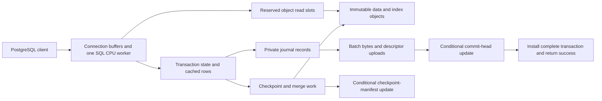

# How pos3ql works

pos3ql serves PostgreSQL SQL and protocol clients while saving durable state in
an S3-compatible object store. A configured object prefix contains one pos3ql
instance's durable state, including its SQL databases. One active process owns
the right to publish changes to that prefix. This is a single active writer
process, not a rule that every storage request must run in sequence.

**Example:** the same instance can contain `orders` and `billing` databases.
Their tables use the same startup memory budget and object-store namespace.
A backup or writer replacement concerns that namespace; creating a SQL database
does not create an independently operated storage service.

## The request path

Connection input, parsed SQL, statement workspaces, transaction undo, locks,
object requests and output have separate fixed reservations. Catalog descriptions
retain their actual columns, rather than full 1,600-column table definitions,
in statement memory. Execution schemas share the existing startup image pool.
After startup, ordinary runtime work cannot grow a heap, pool or sort allocation. The isolated
TLS transport uses its separately budgeted pool. The memory plan describes
these reservations; it is not the entire operating-system RSS, kernel socket
memory or the memory used by an independently operated object-storage service.

A reactor waits for sockets and deadlines, then advances ready connections and
maintenance. After each maintenance turn and any queries it wakes, the loop
registers newly opened storage sockets before sleeping. Cleanup therefore keeps
moving on an idle server without requiring another query to wake it.
SQL CPU work currently runs on one worker. An eligible read that
needs a download yields with its original data owners and command deadline;
another connection can run cached work. Adding connections or
`query_workspace_slots` does not add CPU execution workers.

State-changing routines, procedure commit boundaries, administrative work and
large-result reads after their first transport flush still have synchronous
reads. A cold read on one
of these paths can occupy that worker. [PLAN.md](../PLAN.md) tracks their
conversion and the later CPU worker pool separately.

Stored-function dispatch selects the catalog identity and named-input mapping
before evaluating arguments. Arguments and defaults run in declaration order
with the caller's evaluation context. Lookup does not run an argument as a
probe. For example, `setval('order_numbers', nextval('import_numbers'))`
consumes one import number. A literal null can eliminate a strict call during
planning; a null row value still allows the other reached arguments to run.
This call boundary supplies retained execution with an explicit target; it
does not yet make every function body yield during a storage wait.

## Reads and storage layout

The durable layout is log structured: new transactions and saved generations
append immutable objects. Small mutable roots identify the committed log and
checkpoint inventory. An object with a content-derived name is never edited in
place. Local RAM and disk accelerate access and can be rebuilt from durable
state in object-store mode.

| Mechanism | What it saves | Example and limit |
|---|---|---|
| Full-slice column groups, called PAX | Downloads for columns that are not needed | Reading `id, status` can skip a large description column; predicates, reconstruction and exact checks can still require more columns |
| Packed, compressed row deltas | Descriptor and column-object overhead for small changes | Updating a few orders writes small row groups rather than a full wide-table slice |
| Eight-byte column extent alignment | Gives encoded column values aligned offsets within packed objects | This is a layout guarantee, not a CPU throughput or sector-size claim |
| Packed objects and verified byte ranges | Request overhead and unnecessary transferred bytes | Several independently verifiable extents can share an object; a ranged GET fetches the selected extent |
| Sparse row indexes and Bloom filters | Reading generations or groups that cannot contain a row | An absent order number can avoid a data read; several generations can still need checking |
| Durable value indexes | Searching unrelated rows or regions | Btree/hash, geometric bounds, interval bounds and GIN postings narrow candidates; exact SQL and visibility checks still determine results |
| Reuse of unchanged immutable groups | Rewriting already saved data | Checkpoint/merge work can reference unchanged PAX groups; changed groups still need output |
| Memory/disk caches and retained reader buffers | Repeated downloads and repeated decoding after a wait | A resumed query retains completed columns and navigation even if the shared cache evicted them |
| Bounded batches of object requests | Serial network round trips | Missing selected columns and independent physical writes can overlap within configured request slots |

These mechanisms are implemented; their production benefit has not been
quantified. PAX is a column-group layout within saved row generations. It does
not imply a separate user-selectable columnar table access method, vectorized
SQL execution, multi-core queries or Parquet compatibility.

An immutable sorted row file, or SST, orders versions by row identity and
commit position. Newer versions are considered before older versions for the
same row. A reader combines applicable saved generations with its resident
changes and deletion markers. Large rows can require an overflow chain;
reading one row is therefore not a fixed number of GET requests.

See [index navigation](index-navigation.md) for searchable summaries and exact
checks, and [durable formats](durable-format.md) for encodings and accepted
readers. PostgreSQL's catalog alignment and heap properties describe the SQL
interface; they do not prescribe pos3ql's object layout.

## Writes and the success response

1. SQL checks permissions, constraints and locks and prepares private row and
   catalog changes. Rollback records and journal staging must fit their pools.
2. A commit captures immutable journal bytes and a descriptor. Independent
   uploads can overlap, and several transactions can share the publication.
3. A conditional update advances the commit head only after the required
   uploads succeed. It preserves the committed predecessor and writer identity.
4. The complete transaction installs in memory, its visible position advances,
   locks release, and the server can send success.

**Example:** updating an order and its invoice in one transaction cannot expose
one changed value and one unchanged value during installation. An older report
can retain its earlier values. A new command waits through the installation
boundary rather than observing half a transaction.

The commit head is ordered because confirmed transactions need one recoverable
history. This does not require serial uploads or serial future CPU execution.
Parallel CPU execution remains unfinished; concurrent object I/O is already
implemented. More upload slots do not remove root-update latency or conflicts
between transactions updating the same row.

With `object_store = off`, success instead requires local journal durability.
That mode cannot recover lost local-only data from an object store. With
object storage on, a lost success reply is an uncertain client outcome, not
permission to repeat an external payment blindly.

## Maintenance and scheduling

The server advances checkpointing, file merges, history cleanup, heap relocation
and eligible deletion in bounded turns. It runs between client messages and
while idle. Socket readiness resumes blocked network requests; owner contention
and failed maintenance use the existing one-second retry cadence. A quota of
64 visited row slots is a work bound, not a latency guarantee for a turn.

A checkpoint writes captured committed versions and publishes a complete
manifest, the inventory of saved objects and definitions. Later commits remain
in the journal. Finishing an older checkpoint cannot clear newer writes or
ANALYZE results. Merges combine saved generations, retaining the versions needed
by readers. Object deletion respects current roots, retained readers and backups.
There is no need for an operating-system cron entry to drive this internal work.

Application jobs, migration scheduling and backup schedules are operator work.
There is no built-in SQL job scheduler or PostgreSQL background-worker ABI.
See [operations](operations.md#scheduled-work-and-schema-migrations) for examples
and [backup rules](backup-restore.md) before scheduling an offline backup command.

## Memory and physical size

An empty engine still reserves metadata for configured table slots. Row lookup
positions scale with `max_tables × table_rows`; wide table definitions and other
metadata also reserve capacity before tables are created. MVCC row history uses
the explicit shared `row_history_slots` capacity across all tables and large
objects; `max_row_versions_per_row` remains a separate per-row bound. Locking
mode reserves no committed-row history. An update owns its prospective history
slot with its pending row chain, before durability. Queued and prepared commits
keep that ownership; commit links the reserved slot without allocating another,
and rollback releases it. History exhaustion returns `54000` at the write boundary.
Obsolete versions can be reclaimed while newer readers are active. On slot
pressure, write admission examines at most 64 row metadata positions and retries
with its owned input. Each history chain has the separate per-row version bound.
It never repeats SQL expressions or drains the whole
database synchronously; remaining pressure returns the named capacity error.
Per-table metadata can still make many small embedded tables expensive.
Pending table definitions reserve their complete payload capacity at startup,
but initialize only dense occupancy locks. Wide payload pages are touched when
a definition is staged; its matching read/write guard protects initialization,
retirement and reuse. Reserving unused slots does not initialize every payload.

The [embedded memory measurement](https://github.com/e6qu/pos3ql/blob/6ff1ac865a86a5318cb4934fbf01be0926667811/examples/embedded-memory.rs) starts one empty
engine per process and reports the configured reservation, startup budget drawn,
peak resident memory and startup time. CI records 1, 8 and 32 configured tables
with both transaction modes and the same explicit memory settings. These are
empty-engine measurements, separate from a server's connection buffers, query
workloads and production throughput.
The retained [empty-engine baseline](https://github.com/e6qu/pos3ql/blob/6ff1ac865a86a5318cb4934fbf01be0926667811/benchmarks/baselines/2026-10-30-embedded-startup/README.md)
includes raw measurements and their revision; its resident costs must not be
mistaken for configured byte reservations or a production minimum.
The helper uses the same explicit 128 MiB virtual stack reservation as the
server and native tests; ordinary operating-system thread defaults are not the
current execution contract. Peak resident memory includes the pages actually
touched. The debug-build helper records this stack size with each sample.
It also records each successful named startup reservation, so a large fixed
cost can be traced to its owning pool rather than inferred from total memory.
The retained [component breakdown](https://github.com/e6qu/pos3ql/blob/6ff1ac865a86a5318cb4934fbf01be0926667811/benchmarks/baselines/2026-10-30-embedded-components/README.md)
shows substantial fixed and per-table definition reservations in that revision;
reserved bytes alone do not establish which pages became resident.
The [before/after measurements](https://github.com/e6qu/pos3ql/blob/4054a6d3c79e916728f8e84d84139eae6d86b501/benchmarks/baselines/2026-10-30-embedded-lazy-definitions/README.md)
show empty-engine peak memory falling from about 735 MiB to 431 MiB with 32
configured table slots after unused pending definition payloads were left
uninitialized. Those debug-build samples establish neither populated-table
costs nor a production memory minimum.

Capacity is the smallest applicable bound, not just the size of the bucket:

| Boundary | Current bound and practical meaning |
|---|---|
| Encoded immutable block | At most 262,144 bytes including its 52-byte header; payload at most 262,092 bytes |
| Saved row overflow | An inline head plus at most 16 overflow blocks; assembled encoded row at most 4,455,030 bytes. Input, statement and result buffers can impose smaller bounds |
| External execution-run row | At most 262,072 encoded bytes without overflow chaining, before other statement-memory limits |
| One row-generation roster | At most 8,190 referenced physical blocks, excluding the roster itself; indexes, filters, descriptors and overflow consume entries too |
| Index navigation within a generation | At most 4,096 index leaves; leaf and root addressability do not override the smaller physical-block roster |
| Resident row heap | `memtable_bytes` at most 4,294,967,295 bytes per buffer, with two buffers reserved; these are cache limits, not total durable table size |
| Table catalogs | `max_tables` at most 10,000 user table slots across the instance, plus the internal large-object relation; materialized-view backing tables consume slots |
| Global saved-block inventory | `checkpoint_live_blocks` must cover the distinct reachable block identities, including retained readers and backup data |
| Additional startup bounds | Manifest bytes, replayed commit batches, generations per table, merge/write entries, locks, transaction changes, connections and statement memory can fill first |

The 8,190-block roster gives a gross upper bound of about 2 GiB of framed
referenced block bytes for one generation if all blocks are full. It does not
promise a 2 GiB user table: metadata consumes entries, blocks can be short,
compression changes logical size, and a table can use several generations.

**Sizing example:** `checkpoint_live_blocks = 65536`, as in the development
configuration, corresponds to at most 16 GiB of full 256 KiB referenced block
bytes in that inventory. Small packed objects, metadata, indexes, historical
versions and backups reduce the useful row-data share. It is not a demonstrated
16 GiB database capacity or a limit that the object-store provider imposes.
Increasing a reservation requires a new startup plan and memory; it never grows
automatically. A larger bucket alone does not fix an exhausted inventory.

`table_rows` limits resident row metadata, not all saved rows. Saved rows can
stream from immutable generations, but uncommitted changes and needed history
still consume resident capacity. A single large transaction can exhaust memory
while the durable table is small. Named exhaustion usually returns `54000`;
PostgreSQL-specific width errors retain their own codes. The
[capacity inventory](postgresql-18-compatibility.md#capacity-boundaries) owns
exact SQL widths and per-workspace reservations.

There is no qualified maximum database size, bandwidth, statements per second
or transactions per second for an independently operated deployment. The
[performance guide](performance.md#estimating-bandwidth-and-throughput) gives
explicit calculations and dated measurements without turning them into a
production guarantee.

## Schema migrations and binary changes

Application schema migrations use supported SQL through a normal client.
Changes such as ADD COLUMN, CREATE INDEX and type rewrites have their ordinary
locks, memory requirements and validation costs. Transactional DDL and savepoints
do not make a migration nonblocking or make an arbitrarily large rewrite fit.
A migration tool must coordinate which client applies each version; pos3ql does
not supply a migration runner or migration-history table.

Changing the pos3ql binary is separate. Earlier pos3ql format compatibility is
not required and there is no automatic format migration. Read the
[format matrix](durable-format.md), retain a recoverable source and verify a
logical export/restore when formats differ. A same-prefix backup does not
convert its bytes to a new format. PostgreSQL physical backup/WAL tools cannot
read pos3ql objects.

## Source map and outstanding work

| Source | Responsibility |
|---|---|
| `src/server.rs`, `src/pg/` | Connections, wire protocol, readiness events, retained waits and response order |
| `src/sql/` | Parsing, type checks, execution, transaction coordination and PostgreSQL catalogs |
| `src/storage/` | Resident versions, locks, retained definitions, object lifetimes and fixed metadata pools |
| `src/wal/` | Journal record framing, checksums, staging and recovery codec |
| `src/checkpoint.rs` | Saved generations, merges, manifest publication, retention and cold recovery |
| `src/store/` | Block formats, compression, immutable indexes, ranged access and cache tiers |
| `src/object_store.rs`, `src/object_store/` | Provider-neutral outcomes, S3 HTTP/TLS, signing and conditional operations |
| `src/mem/`, `src/config.rs` | Startup sizing, fixed buffers/pools and allocation enforcement |

`src/storage/catalog_identities.rs` checks durable catalog creation stamps and
counter reservations. `default_acls.rs` keeps a default-permission group's
identity separate from its recipients; `partition_triggers.rs` stores inherited
trigger identities and modes in the existing startup-reserved matrix. SQL records
private changes for rollback and publishes their final expected/replacement
images at commit. Checkpoint and journal readers restore saved positions and
reject references to replacement objects. Database copies rebind parent links
within the new database before installing inherited triggers.

Journal cleanup uses a separate fixed metadata client and retains its listing,
backup-retention and deletion positions across socket waits. It can run while
foreground block reads and journal uploads wait. It has its own fixed backup
list and deletion queue, so checkpoints can publish and free row-cache space
while obsolete-log requests wait. A pass has a fixed cutoff; newer checkpoints
queue the latest next cutoff instead of restarting the active pass.
Saved-file cleanup uses a second fixed client and retains its backup, manifest,
row-roster, index-tree and deletion positions across waits. Its cache probes
preserve query read owners. It validates the complete keep-set before deleting
files, then continues each listing from its saved cursor. Durable file writers
remain paused while that decision drains; foreground RAM edits can continue.
Row-file merges retain index descent, source-row scheduling, column downloads
and large-row fragments while a request waits. Scheduling reads row descriptors
without fetching PAX column values. Completed groups stay in the existing source
buffers; checksums and output positions advance only after their rows finish.
The fixed read pool reserves one maintenance owner alongside connections and
subscription workers. Checkpoint row capture, row output, index input scans,
sort-run merges and final index output use the same maintenance owner. Each
retains its exact next input; a waiting job resumes before another job can
reuse that owner's response. Private startup-reserved row and scan buffers keep
partially read values separate from foreground queries. An emitted index row
is consumed once even if fetching its successor has to wait.

For example, while an index on saved `orders(customer_id)` waits for storage,
a cached order lookup and another connection's durable commit can finish.
The index becomes visible as a saved root only after its complete output uploads
and the matching manifest publishes. Replacing its table or changing its inputs
abandons the old job and releases its read request.

The remaining order is coherent shared row/catalog publication and bounded
maintenance, startup-reserved CPU workers, then representative performance and
multi-host recovery/failover qualification. Current [behavior](implemented-baseline.md),
[known limits](postgresql-18-compatibility.md), [operations](operations.md) and
[the plan](../PLAN.md) each own one part of that contract.
